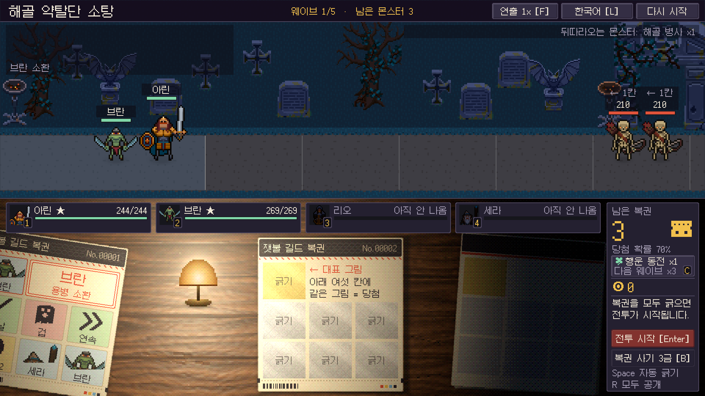
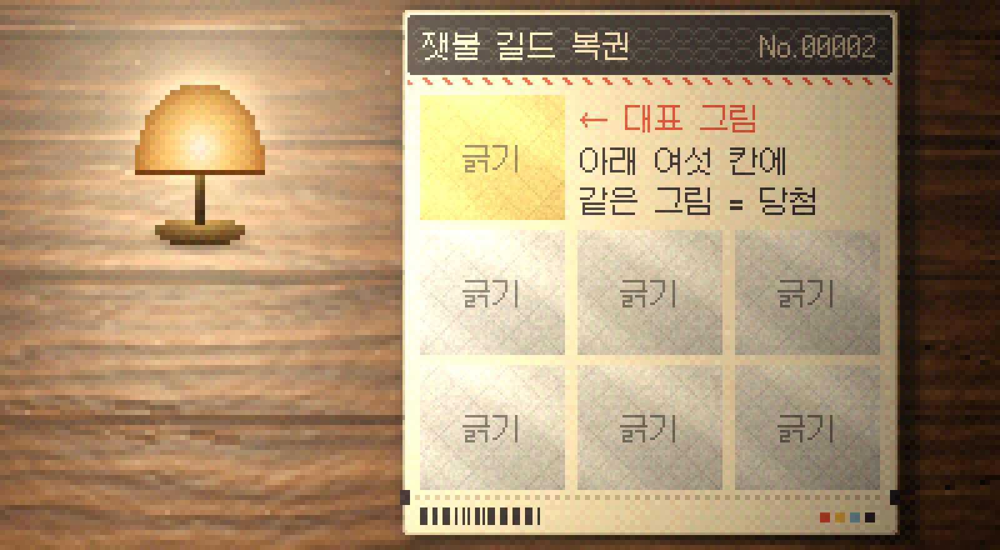
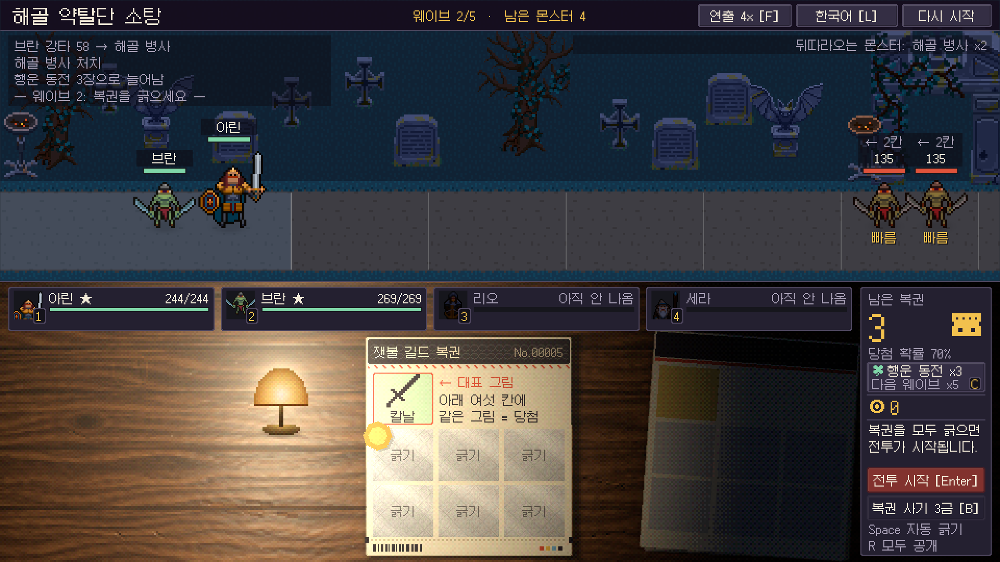

## 정한 방향

복권을 긁는 아래 절반의 연출 방향을 정했습니다.

- **실사 + 픽셀.** 이 조합이 핵심입니다.
- 긁는 장소는 불 꺼진 어두운 곳이고, **무드등 하나의 불빛**에 의존합니다.
- **나무 테이블**에서 복권을 **한 장씩** 보여 주며 긁습니다.

위 절반의 전장과 정보 패널은 그대로 픽셀 아트와 평면 패널입니다. 이전까지는 평평한 책상에 복권 네 장을 한꺼번에 늘어놓았습니다.

{: .shadow }
_왼쪽은 방금 긁어 도장이 찍힌 복권, 가운데가 지금 긁는 복권, 오른쪽 어둠 속이 남은 복권 더미_

## 실사와 픽셀을 섞는 방법

두 단계로 나눴습니다.

1. **계산은 사진처럼.** 등에서 멀어질수록 어두워지는 감쇠, 나뭇결의 요철이 받는 빛, 복권과 더미가 드리우는 그림자, 니스에 비친 등, 등 주위로 번지는 빛을 실제 조명 식으로 구합니다. 밝은 쪽은 흰색으로 타고 어두운 쪽은 등의 색이 남도록 카메라의 응답 곡선을 씁니다. 약한 센서 잡음도 얹습니다.
2. **출력은 픽셀로.** 그 결과를 캐릭터와 같은 크기의 픽셀로 끊고, 밝기를 30단계로 나눠 디더로 섞습니다.

나무 상판과 무드등은 그림 파일 없이 코드로 만들었습니다. 상판은 너비가 다른 널 여러 장이고, 널마다 나뭇결과 색이 다르며, 옹이와 긁힌 자국과 컵 자국이 있습니다. 색과 별도로 결의 기울기와 니스 광택을 담은 표면 정보를 만들어 조명이 읽습니다.

조명은 테이블과 그 위의 물건을 한꺼번에 덮는 두 장입니다. 한 장은 아래 그림에 빛을 곱하고, 한 장은 반사와 번짐을 더합니다. 복권 자체는 고치지 않았습니다. 조명이 위에서 덮기 때문에 복권이 미끄러져 들어오면 저절로 밝아지고, 동전과 은박 가루도 같은 빛을 받습니다.

{: .shadow }
_가까이서 보면 나뭇결과 빛의 단계가 픽셀로 끊겨 있습니다_

## 한 장씩

- 남은 복권은 오른쪽 어둠 속에 더미로 쌓여 있습니다.
- 맨 위 한 장이 불빛 안으로 들어옵니다. 다 긁으면 도장이 찍힌 뒤 등 왼쪽으로 밀려나고 다음 장이 들어옵니다.
- 복권을 사면 더미에 한 장이 얹힙니다.
- 다음 웨이브가 시작되면 테이블을 비우고 새 더미를 놓습니다.

{: .shadow }

## 분위기와 읽기 쉬움

방을 어둡게 할수록 복권의 먼 쪽이 읽기 어려워집니다. 그래서 복권이 받는 빛을 수치로 확인합니다. 값은 인쇄된 그대로를 1로 둔 선형 밝기입니다.

| 위치 | 밝기 |
|---|---|
| 등 바로 아래 | 1.810 |
| 긁는 복권의 왼쪽 가운데 / 가운데 / 오른쪽 가운데 | 1.561 / 0.847 / 0.339 |
| 긁는 복권의 가장 어두운 모서리 | 0.244 |
| 더미의 가운데 | 0.009 |

가장 어두운 모서리의 0.244는 눈에는 인쇄 밝기의 절반 남짓입니다. 이 값이 0.22 아래로 내려가면 테스트가 실패합니다.

## 확인한 것과 못 한 것

- Unity EditMode 테스트 590건이 모두 통과했습니다(테이블 관련 8건 추가).
- 에디터에서 **자동 진행**으로 웨이브 1의 복권 4장과 웨이브 2의 시작을 확인했습니다. 콘솔 오류는 없었습니다.
- **사람이 직접 긁어 본 검증은 아직 없습니다.** 한 장씩 넘어가는 박자가 지루하지 않은지, 포인터 동전이 조명 아래에서 잘 보이는지는 해 봐야 압니다.
- 다른 해상도, 프레임 시간, 빌드에 셰이더가 들어가는지도 확인하지 못했습니다.
- 은박이 등 불빛에 반짝이는 표현, 종이의 결은 아직 없습니다.
