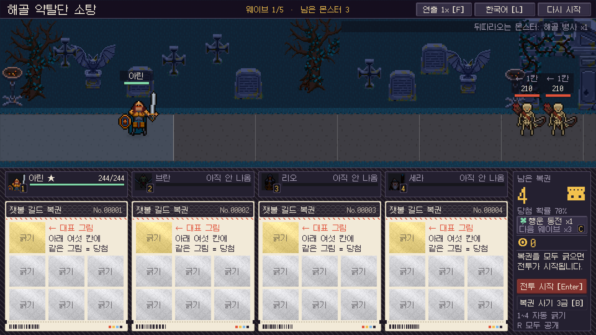
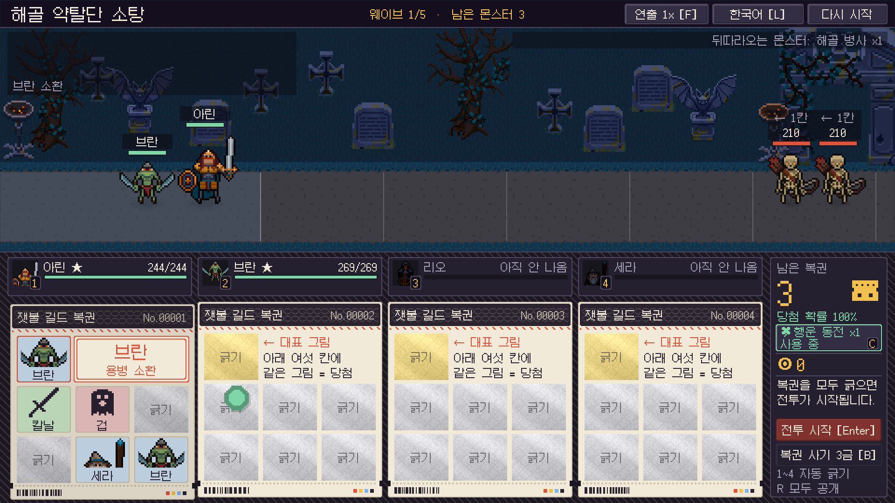
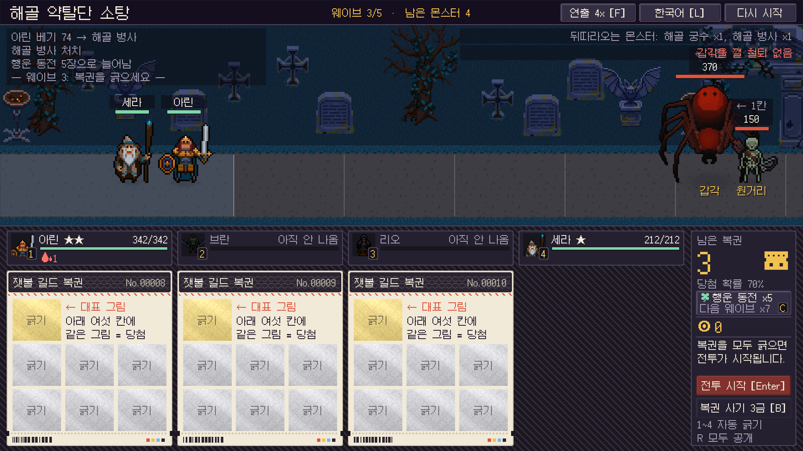

## 한 일

- 동전을 두 종류로 나눴습니다. **기본 동전**은 닳지 않고 효과가 없습니다. **특수 동전**은 복권의 당첨 확률을 올리고, 정해진 장수만큼 쓰면 사라집니다.
- 특수 동전 규칙을 전투 규칙에 넣고 동전 표를 추가했습니다.
- 시뮬레이션에서 첫 안이 판단을 만들지 못한다는 것을 확인하고, **들고 있으면 쓸 수 있는 장수가 늘어나는 동전**으로 바꿨습니다.
- 전투 화면에 동전을 고르는 버튼을 넣었습니다.

## 규칙

- 복권은 처음 긁는 순간 내용이 정해집니다. 그래서 특수 동전은 **복권을 긁기 전에** 손에 듭니다. 긁던 복권이 있으면 동전을 바꿀 수 없습니다.
- 특수 동전을 들고 복권을 시작하면 그 복권의 당첨 확률이 오르고 동전이 한 장만큼 닳습니다.
- 확률을 올릴 수 없는 복권에는 닳지 않습니다. 전장에 용병이 없어 어차피 당첨인 복권이 그렇습니다.
- 한 번도 쓰지 않은 특수 동전은 웨이브를 넘길 때마다 쓸 수 있는 장수가 늘어납니다. 한 번이라도 쓰면 더 늘지 않습니다.

## 첫 안: 당첨 확률만 올리는 동전

처음에는 당첨 확률 +30%p, 3장짜리 동전이었습니다. 기대한 것은 "어려운 웨이브까지 아껴 쓰는 판단"이었습니다.

방식끼리 비교하는 표는 10,000판씩 돌렸습니다. 1,000판은 승률의 오차가 ±2.6%p라서 2~5%p 차이를 가릴 수 없었습니다. 10,000판의 오차는 ±0.8%p입니다.

균형 편성(검 · 철퇴 · 활 · 지팡이), 동전 1개.

| 동전 사용 | 승률 |
| --- | --- |
| 동전 없음 | 78.2% |
| **받자마자 씀** | **83.0%** |
| 웨이브 3부터 | 81.8% |
| 웨이브 4(비행)부터 | 81.2% |
| 웨이브 5(보스)부터 | 78.5% |

- 결과는 기대와 반대였습니다. **빨리 쓸수록 높고, 아낄수록 내려갑니다.** 다른 두 편성에서도 같았습니다.
- 이유는 규칙 구조에 있습니다. 일찍 당첨된 용병은 남은 웨이브 내내 싸우고, 같은 용병이 또 나오면 승급합니다.
- 플레이어가 배울 것이 "받자마자 써라" 하나뿐이면 판단거리가 아닙니다.

## 바꾼 안: 들고 있으면 불어나는 동전

**행운 동전: 당첨 확률 +30%p. 처음에는 1장. 쓰지 않고 웨이브를 넘길 때마다 +2장, 최대 7장.** 기본 복권의 당첨 확률이 70%라서 이 동전으로 긁은 복권은 반드시 당첨됩니다. 지금 확실한 한 장을 쓸지, 기다려서 여러 장을 쓸지를 고르게 됩니다.

| 쓰기 시작하는 웨이브 | 쓸 수 있는 장수 | 승률 |
| --- | --- | --- |
| 동전 없음 | 0 | 78.2% |
| 1 (받자마자) | 1 | 79.9% |
| 2 | 3 | 82.4% |
| **3** | **5** | **83.9%** |
| 4 | 7 | 82.0% |
| 5 | 7 | 78.8% |
| 전장에 답이 없을 때만 | 평균 2.9장 사용 | 83.7% |

- 언제 쓰느냐에 따라 승률이 4~6%p 갈립니다. 서두르면 한 장뿐이고, 너무 아끼면 쓸 복권이 모자라고 이미 진 판은 되돌릴 수 없습니다.
- 웨이브 3이 가장 좋은 이유는 패배가 몰리는 비행 웨이브(4번째)의 한 웨이브 전이기 때문입니다. 웨이브 3에서 당첨된 용병이 웨이브 3과 4를 함께 싸웁니다.
- 한 번 쓰면 성장이 멈추게 한 것은, 한 장만 남겨 두고 계속 불리는 것을 막기 위해서입니다.

### 가장 좋은 때는 의뢰마다 다르다

"웨이브 3에 써라"가 또 하나의 외울 규칙이 되면 판단이 아닙니다. 그래서 같은 다섯 웨이브의 순서만 바꿔서 돌려 봤습니다.

| 비행 웨이브의 위치 | 가장 좋은 때 | 그때의 승률 | 항상 웨이브 3에 쓰면 | 전장에 답이 없을 때만 쓰면 |
| --- | --- | --- | --- | --- |
| 4번째 (원래) | 웨이브 3 | 83.9% | 83.9% | 83.7% |
| 3번째 | 웨이브 3 | 77.0% | 77.0% | 76.9% |
| 2번째 | 웨이브 2 | 65.7% | 59.3% | 65.9% |
| 5번째 | 웨이브 3 | 81.0% | 81.0% | 80.8% |

- 비행 웨이브가 2번째로 오면 웨이브 2가 가장 좋고, 웨이브 3에 쓰면 6.4%p를 잃습니다.
- "전장에 답이 없을 때 쓴다"(비행이 오는데 활 · 지팡이가 없거나, 갑각이 오는데 철퇴가 없을 때)는 네 순서 모두에서 최선과 0.2%p 안이었습니다. 숫자를 외우는 쪽이 아니라 다가오는 웨이브와 내 편성을 읽는 쪽이 이깁니다.

## 동전을 고르는 화면

{: .shadow }
_들고 있지 않을 때: 오른쪽 기둥의 버튼에 "행운 동전 ×1 · 다음 웨이브 ×3"_

{: .shadow }
_손에 들었을 때: 당첨 확률 100%, 복권 위의 동전이 초록색_

- 오른쪽 기둥의 동전 버튼이 손에 든 동전, 남은 장수, 이번 웨이브를 넘기면 몇 장이 되는지를 보여 줍니다.
- 버튼 위의 당첨 확률이 손에 든 동전에 따라 바뀝니다. 복권 위의 동전도 손에 든 동전의 색이 됩니다.
- 버튼을 누르거나 `C`로 바꿉니다. 긁던 복권이 있으면 바꿀 수 없습니다.
- 다가오는 몬스터에 대응할 용병이 없으면 전장에 경고가 뜹니다(비행이 오는데 활 · 지팡이가 없을 때, 갑각이 오는데 철퇴가 없을 때). 시뮬레이션에서 최선에 가까웠던 "답이 없을 때 쓴다"를 사람이 따라 할 수 있게 하는 표시입니다.
- 특수 동전을 얻는 상점이 아직 없어서, 시제품 의뢰는 시작할 때 행운 동전 1개를 줍니다.

## 웨이브별 복권 장수

| 웨이브 1 · 2 · 3 · 4 · 5 | 승률 | 긁는 복권 |
| --- | --- | --- |
| **4 · 3 · 3 · 3 · 4 (지금)** | **78.2%** | 17.7장 |
| 3 · 3 · 3 · 3 · 3 | 73.4% | 15.4장 |
| 6 · 2 · 2 · 2 · 3 | 75.2% | 15.7장 |
| 5 · 3 · 3 · 3 · 4 | 81.8% | 19.1장 |
| 4 · 4 · 4 · 4 · 4 | 86.4% | 21.5장 |

- 복권 한 장은 웨이브 1에서 3.6%p, 웨이브 4에서 2.4%p의 값입니다. 같은 15장이라도 앞에 몰아 준 쪽이 높습니다.
- 목표 승률을 아직 정하지 않아서 지금 값을 유지합니다.

## 확인한 것

- Unity EditMode 테스트 582건 통과(새 테스트 12건).
- 표 8개 39행 검사에서 문제 0. 문자열 표 132키 × 5개 언어.
- 동전을 쓰지 않으면 같은 시드의 전투가 이전과 완전히 같습니다(1,000판 승률 77.6%, 동전을 넣기 전과 같음).
- 시뮬레이션을 화면 없는 실행 환경과 Unity 에디터 양쪽에서 돌려, 1,000판의 승률과 웨이브별 패배 수가 같은 것을 확인했습니다.
- 전투 화면을 실행해 동전 버튼, 손에 들었을 때의 확률 100%와 초록 동전, 다 쓴 뒤 기본 동전으로 돌아오는 것을 확인했습니다. 행운 동전으로 시작한 복권은 확률 100%로 당첨됐습니다.
- 동전을 쓰지 않고 웨이브 두 개를 넘기는 자동 진행에서 1 → 3 → 5장으로 늘어나는 것과, 갑각 괴수가 왔는데 철퇴 용병이 없을 때 경고가 뜨는 것을 확인했습니다.

{: .shadow }
_두 웨이브를 아낀 뒤: 행운 동전 ×5, 전장 오른쪽 위에 "갑각을 깰 철퇴 없음"_

테스트 · 시뮬레이션 · 자동 진행은 사람 플레이 검증이 아닙니다. 동전을 쓰는 화면은 직접 플레이한 한 판을 관찰했습니다.

## 확인하지 못한 것

- 4~6%p 차이를 사람이 "내 판단이 통했다"로 느끼는지, 기다리는 것이 재미있는지 모릅니다.
- 특수 동전을 얻는 경로(상점, 보상 복권)가 없습니다.
- 의뢰가 하나뿐입니다. 순서만 바꿔 봤고, 다른 몬스터 구성에서는 확인하지 않았습니다.
- 한국어 외의 언어와 1920×1080 밖의 해상도에서 동전 버튼을 보지 못했습니다.

## 다음

- 여러 판을 직접 해 보고 기다리는 재미가 있는지, 경고를 보고 쓰는 때를 고르게 되는지 확인합니다.
- 특수 동전을 얻는 경로(상점)를 만듭니다.


