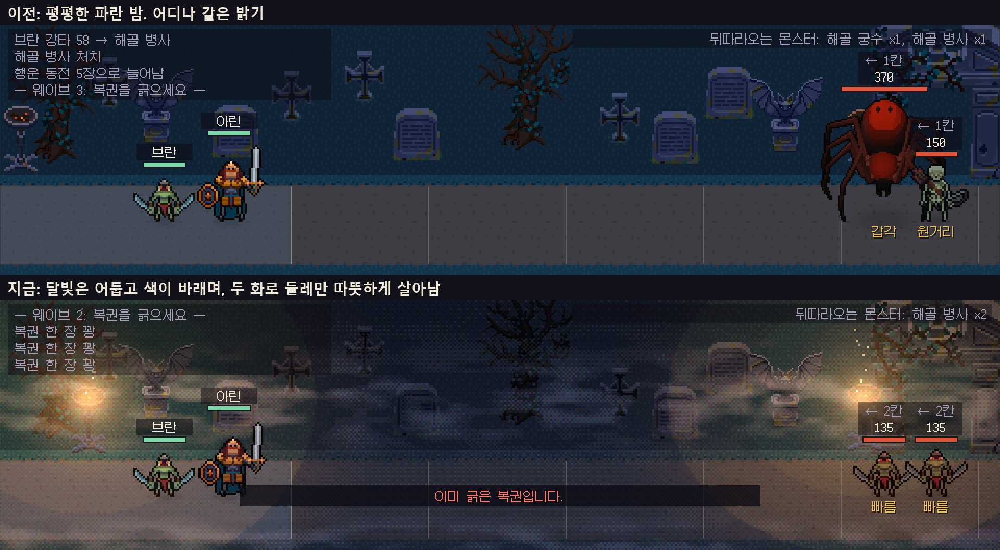
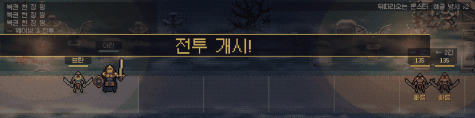
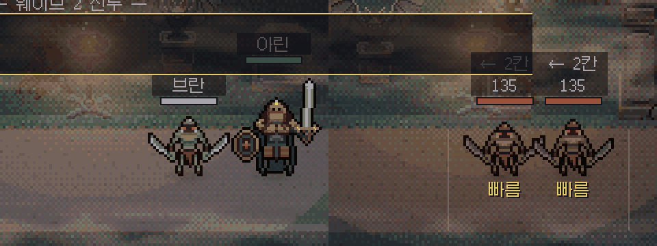
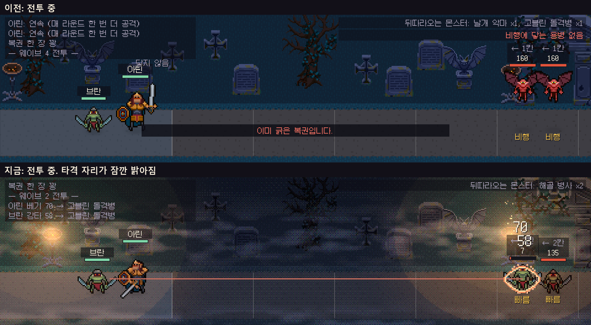

## 요청

아래 절반의 긁는 자리는 불 꺼진 방과 무드등으로 분위기가 잡혔는데, 위 절반의 전투 화면은 평평한 파란 밤 그대로였습니다. 요청은 "전투쪽도 Light랑 분위기좀 잡아줬으면 좋겠어"였고, 방향은 정해지지 않았습니다. 그래서 방향을 먼저 정하고 넣었습니다.

{: .shadow }
_위가 이전, 아래가 지금_

## 정한 방향

- **차가운 달빛과 따뜻한 화로 둘.** 화로 하나는 용병단 뒤에, 하나는 몬스터가 걸어 나오는 문 앞에 있습니다. 몬스터는 문의 불빛에서 나와 어두운 길을 지나 용병단의 불빛으로 들어옵니다.
- **밤에는 색이 바랜다.** 달빛만 받는 배경은 회청색에 가깝고, 불빛이 닿는 곳에서만 색이 살아납니다.
- **인물은 읽혀야 한다.** 인물에게만 보조광을 더 줍니다. 무대가 배우를 세트보다 밝게 비추는 것과 같습니다. 이름표, 체력 막대, 숫자는 조명을 받지 않습니다.
- **불은 움직인다.** 불빛이 불꽃 그림의 프레임에 맞춰 흔들리고, 불씨가 오르고, 무덤 사이로 안개가 흐릅니다.
- **타격이 전장을 밝힌다.** 맞은 자리가 그 공격의 색으로 잠깐 밝아집니다. 이 게임의 중심은 "복권의 효과가 전장에서 실현되는 모습"인데, 그것을 빛으로도 보이게 하려는 것입니다.

정하기 전에 픽셀 아트의 밤 표현과 2D 게임의 조명 기법을 찾아봤습니다. 그림자는 밝기만 낮추지 말고 차가운 쪽으로 색을 옮긴다는 것([Pixnote](https://pixnote.net/en/learn/shading)), 빛 지도를 장면에 곱하고 그림의 픽셀 격자에 맞춰 끊는다는 것([Lighting in 2D Games](https://slembcke.github.io/2D-Lighting-Overview)), 불빛을 흔들면 옆에 선 인물도 같이 흔들려 보이게 한다는 것([Innkeep 개발 글](https://www.moddb.com/games/innkeep/features/innkeep-making-basic-lighting-in-a-2d-game))을 가져왔습니다. 묘지가 배경인 [Graveyard Keeper의 그래픽 글](https://slava.lazybeargames.com/graveyard-keeper-how-the-graphics-effects-are-made)은 밤에 푸른 기운을 띠는 주변광과 가로로 긴 구름 층의 안개를 설명합니다.

## 만든 방법

긁는 자리와 같습니다. 계산은 사진처럼 하고 출력은 픽셀로 끊습니다.

1. 한 자리가 받는 빛을 더합니다: 달빛(먼 곳과 양 끝은 어둡게) + 화로 둘 + 타격 빛. 인물은 보조광을 더 받습니다.
2. 화로의 빛은 거리에 따라 줄고 끝이 네 단으로 끊깁니다. 손으로 칠한 빛처럼 보이게 하려는 것입니다.
3. 그 빛을 캐릭터 픽셀 하나 크기마다 계산해 16단계로 끊고 디더로 섞은 뒤, 스프라이트 색에 곱합니다. 불빛이 약한 곳일수록 색을 회색 쪽으로 덜어 냅니다.
4. 배경 위, 인물 아래에 공기 한 장을 더합니다: 안개, 불꽃 둘레의 번짐, 불씨.

구매한 그림은 고치지 않았습니다. 그림을 그리는 재질에 빛을 곱하는 계산을 더했을 뿐입니다.

{: .shadow }
_실제 진행을 프레임마다 찍어 이은 것. 캡처가 프레임을 늦춰 실제보다 끊겨 보입니다_

{: .shadow }
_왼쪽이 용병단 뒤의 화로, 오른쪽이 문 앞의 화로. 불꽃, 번짐, 불씨, 따뜻한 웅덩이_

{: .shadow }
_아래 화면에서 오른쪽 몬스터가 맞는 순간 둘레가 밝아져 있습니다_

## 분위기와 읽기 쉬움

어둡게 할수록 몬스터를 읽기 어려워집니다. 그래서 인물이 받는 빛을 수치로 확인합니다. 값은 그림 그대로를 1로 둔 선형 밝기이고, 불꽃이 가장 어두운 프레임일 때의 값입니다.

| 자리 | 인물 | 바닥 |
|---|---|---|
| 용병단 뒤 | 1.018 | 0.536 |
| 길 한가운데 | 0.649 | 0.180 |
| 문 앞 | 0.861 | 0.410 |

길 한가운데에서 인물은 바닥보다 3.6배 밝습니다. 인물이 어디서든 0.5 아래로 내려가면 테스트가 실패합니다.

## 흔들림을 줄인 이유

처음에는 불빛의 세기와 함께 빛 웅덩이의 가장자리도 흔들었습니다. 그런데 계산해 보니 네 단의 경계가 땅 위를 쓸고 지나가면서 **전장 넓이의 23.5%가 1초에 일곱 번씩 10% 넘게 밝기가 바뀌었습니다.** 번쩍임 기준(WCAG 2.3.1)을 넘는 양입니다. 가장자리는 멈추고, 세기만 ±4% 안에서 흔들리게 했습니다. 지금은 전장의 어느 자리도 10% 넘게 바뀌지 않고, 테스트가 이것을 지킵니다.

## 고친 것

- 첫 판은 안개가 너무 진하고 달빛이 밝아, 밤이라기보다 뿌연 청록색 화면이었습니다. 달빛을 두 번 낮추고 인물 보조광과 색 바램을 넣어 지금 화면이 됐습니다.
- 불씨가 처음에는 하나도 보이지 않았습니다. 셰이더가 불씨 자리를 반 칸 어긋난 좌표와 비교하고 있었습니다.
- 용병단 쪽 화로가 화면 왼쪽 끝에 붙어 빛의 절반이 화면 밖으로 나가고 있어서, 용병단 뒤로 옮겼습니다.

## 확인한 것과 못 한 것

- Unity EditMode 테스트 604건이 모두 통과했습니다(전장 조명 8건 추가).
- 자동 진행으로 전투를 돌리며 프레임을 찍어 타격 빛, 불씨, 안개가 움직이는 것을 봤습니다. 사람이 직접 해 본 확인은 아닙니다.
- **사람 플레이 검증은 아직 없습니다.** 어두워진 전장에서 몬스터를 한눈에 읽을 수 있는지, 오래 보면 눈이 피로한지는 해 봐야 압니다.
- 빛 웅덩이의 네 단 경계가 큰 타원으로 보입니다. 채색한 빛처럼 보이려는 의도지만 딱딱해 보일 수도 있습니다.
- 타격 빛의 번쩍임 넓이는 어림만 했고, 프레임 시간, 다른 해상도, 빌드는 확인하지 않았습니다.
