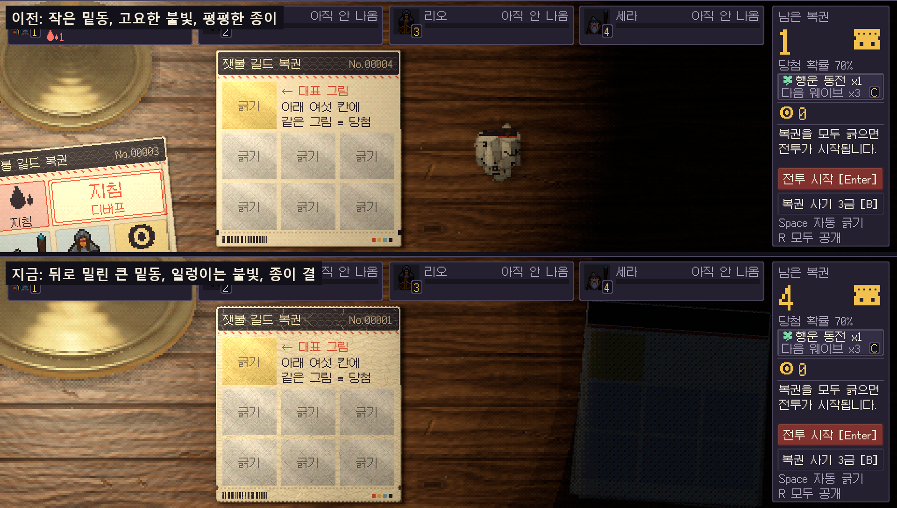
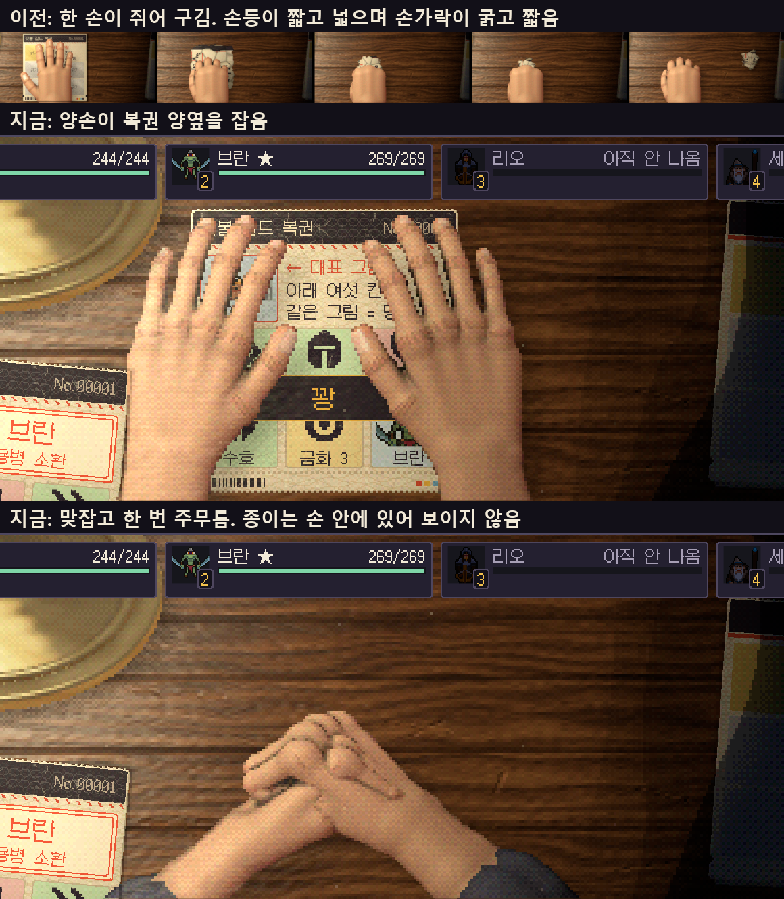
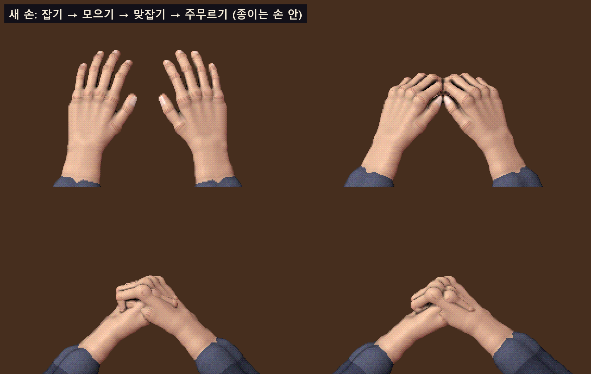
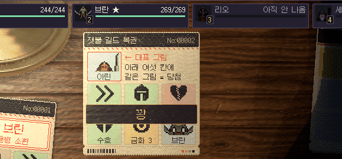
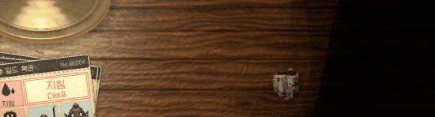
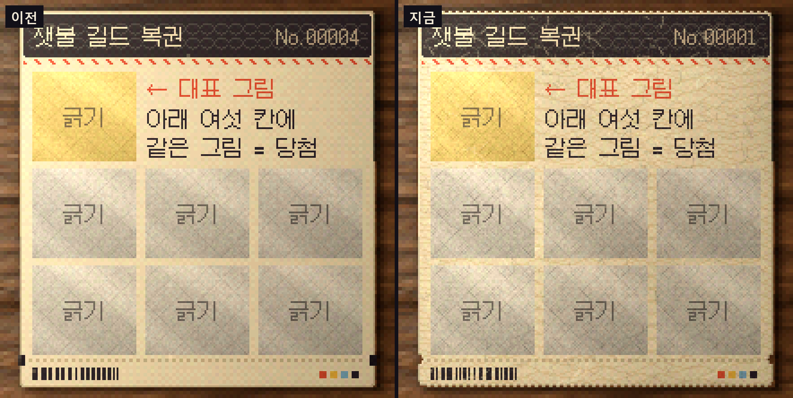

## 직접 해 보고 받은 지적

[지난 글](/posts/scratch-desk-real-pixel/)의 테이블을 만든 뒤, 꽝 복권을 손이 구겨 던지는 연출과 무드등의 밑동을 넣었습니다. 그 화면을 직접 해 보고 나온 지적은 이렇습니다.

- 구길 때는 **양손으로 악수하듯이** 맞잡고, **한 번 주무르고 버린다.**
- 구길 때 **종이는 손 안에** 있어야 한다. 손 밖으로 튀어나오면 안 된다.
- **손이 못생겼다.** 손가락 마디, 손등과 손날의 비율이 좋지 않다. 정보가 부족하면 자료 조사를 더 한다.
- 무드등은 **더 큰 등**이고, 밑동은 **절반쯤만 보이게 뒤로** 밀려 있으면 된다.
- 불빛은 **아지랑이처럼, 애니메이션 스타일로 일렁인다.**
- 복권은 **진짜 현물 종이처럼** 생기고 **종이 질감**이 있어야 한다.

{: .shadow }
_위가 이전, 아래가 지금. 등은 커져서 뒤로 물러났고, 빛의 끝은 몇 단으로 끊겨 흔들리며, 복권에는 종이 결과 톱니 가장자리가 생겼습니다_

## 손: 왜 어색했는지부터

처음 손은 감으로 만든 것이었습니다. 지적을 받고 손 그리는 법과 인체 치수를 찾아 코드의 수치와 나란히 놓으니 틀린 곳이 보였습니다.

| 항목 | 이전 손 | 찾은 기준 | 고친 손 |
|---|---|---|---|
| 손 길이 ÷ 너비 | 약 1.9 | 약 2.2 | 2.2 |
| 손등 길이 대 가운데 손가락 | 손가락이 손등에 묻혀 짧아 보임 | 거의 같다 | 36 대 39.5 |
| 손가락 굵기 ÷ 손 너비 | 27% | 약 20% | 21~22% |
| 손등 | 둥글고 두꺼운 덩어리 | 납작하다 | 뼈 넉 줄이 나란한 판, 힘줄 결이 남음 |
| 마디 | 구분 없음 | 관절이 조금 굵다 | 굵은 마디, 등 쪽 주름선, 솟은 손등 관절 |
| 손톱 | 손끝 윗면 전체 | 손가락보다 좁다 | 너비의 72%, 끝마디 중간부터 |

기준은 그림 쪽 자료([Clip Studio의 손 그리기 글](https://tips.clip-studio.com/en-us/articles/6936), [Proko의 손뼈 강의](https://www.proko.com/course-lesson/how-to-draw-hand-bones-anatomy-for-artists))와 인체 치수 자료에서 가져왔습니다. 인체 치수는 검색 요약으로 본 값이고 원 보고서의 표를 직접 열어 확인한 것은 아닙니다.

손은 여전히 그림 파일이 아닙니다. 둥근 뼈대를 어른 손의 치수대로 놓고, 위에서 내려다본 모습을 빛을 계산해 그린 뒤 픽셀로 끊습니다. 두 손을 한 그림에 함께 그리기 때문에 맞잡았을 때 한 손의 손가락이 다른 손 위에 얹힙니다.

{: .shadow }
_맨 위가 이전의 한 손. 아래 둘이 지금의 양손입니다_

{: .shadow }
_잡기, 모으기, 맞잡기, 주무르기_

## 구기는 과정

양손이 가까운 가장자리에서 들어와 복권 양옆을 잡고, 모으고, 맞잡아 한 번 주무른 뒤, 뭉치를 어둠 쪽으로 놓습니다. 손을 모은 뒤로 종이는 손 안에 있습니다. 맞잡은 동안에는 전혀 보이지 않다가 뭉치가 되어 나옵니다.

{: .shadow }
_실제 진행을 프레임마다 찍어 이은 것(약 2초). 캡처가 프레임을 늦춰 1초에 12장쯤이라 실제보다 끊겨 보입니다_

첫 시도에서는 맞잡은 손 위로 종이가 삐져나오게 그렸습니다. 구겨지는 종이가 보여야 한다고 생각해서였는데, 직접 본 쪽의 판단은 반대였습니다. 손 안에서 일어나는 일은 보이지 않는 편이 맞았습니다.

## 불빛: 끝까지 닿게 했다가 되돌림

"테이블에 빛이 다 닿아야 한다"는 말에 빛의 높이를 올리고 범위 제한을 없애 오른쪽 끝까지 닿는 판을 만들었습니다. 그 판을 본 뒤의 결정은 "불빛은 그 전처럼"이었습니다. 숫자로는 요청대로였지만 어두운 방이라는 분위기가 사라졌습니다. 그래서 등 둘레만 밝은 불빛으로 되돌리고, 대신 일렁이게 했습니다.

- 빛의 고리가 등 둘레를 천천히 도는 물결을 따라 몇 픽셀씩 밀리고 당겨집니다.
- 손으로 그린 애니메이션처럼 1초에 8장만 바뀝니다.
- 빛의 끝은 그냥 흐려지지 않고 세 단으로 끊깁니다. 흔들리는 것이 눈에 보이는 곳이 이 단의 경계입니다.

{: .shadow }

분위기가 복권의 읽기 쉬움을 해치지 않는지는 수치로 봅니다. 값은 인쇄된 그대로를 1로 둔 선형 밝기입니다.

| 위치 | 밝기 |
|---|---|
| 긁는 복권의 가운데 | 0.782 |
| 가장 어두운 모서리 | 0.451 |
| 같은 모서리, 흔들림이 가장 불리한 순간 | 0.399 |
| 남은 복권 더미의 가운데 | 0.008 |

가장 불리한 순간의 값이 0.22 아래로 내려가면 테스트가 실패합니다. 3.7초 동안 44장을 찍어 프레임 사이의 차이를 재 보니(255 기준 평균) 빛의 가장자리는 3.75, 복권 위는 2.08이었습니다. 가장자리는 눈에 띄게 움직이고 복권 위는 거의 그대로입니다.

## 복권: 실물 종이처럼

실물 즉석복권이 어떻게 만들어지는지부터 확인했습니다. [제조 과정을 설명한 글](https://www.encyclopedia.com/manufacturing/news-wires-white-papers-and-books/instant-lottery-ticket)에 따르면 빳빳한 종이 위에 프라이머, 혼동 무늬, 당첨 숫자, 밀봉 코트, 알루미늄 페이스트나 카본 블랙을 섞은 가림 코트, 덧인쇄가 차례로 올라가고, 꺼내기 쉽게 천공합니다. 이것을 화면에 옮겼습니다.

- 띠에서 뜯어낸 낱장: 위아래 가장자리가 톱니이고 모서리가 둥급니다. 반권 절취선의 양 끝에는 반달 구멍이 있습니다.
- 색이 고르지 않은 바탕에 섬유가 흩어져 있고, 옅은 물결 무늬가 깔려 있습니다.
- 가장자리에 두께가 보입니다. 등 쪽은 밝고 반대쪽은 그늘입니다.
- 인쇄와 긁는 칸 위에도 종이 결을 얇게 한 겹 얹었습니다. 긁는 칸에는 작은 마름모가 반복해 찍혀 있습니다.

배치와 문구는 그대로입니다. 한국 즉석복권의 용지 규격은 찾지 못했습니다.

{: .shadow }

## 자동 진행

요청이 하나 더 있었습니다. 위 줄의 `자동` 버튼을 켜면 테이블의 복권을 긁고, 버프나 디버프를 받을 용병을 고르고, 금화가 되면 복권을 사는 일을 화면이 대신합니다. 전투와 다음 웨이브는 원래 저절로 진행되므로 켜 둔 채로 한 판이 결과 화면까지 갑니다. 판단 기준은 밸런스 시뮬레이션이 쓰는 것과 같게 했습니다. 손에 든 특수 동전은 바꾸지 않습니다.

기획서의 조사에는 "자동화가 판단을 지우면 중독되지만 재미없다"는 다른 게임의 사례가 적혀 있습니다. 자동 진행은 이 게임의 판단을 그대로 대신하므로 기본은 꺼 두었습니다. 켜 둔 플레이가 재미를 해치는지는 사람이 해 봐야 압니다.

## 확인한 것과 못 한 것

- Unity EditMode 테스트 596건이 모두 통과했습니다(테이블 관련 14건).
- 꽝이 나올 때까지 세 판을 자동 긁기로 돌렸고, 세 판 모두 양손이 구겨 버리는 순서가 끝까지 돌았습니다. 마지막 판은 프레임마다 찍었습니다(23장).
- 자동 진행을 켜고 두 판을 입력 없이 돌렸습니다. 한 판은 넷째 웨이브에서 졌고, 한 판은 다섯 웨이브를 모두 이겼습니다. 4배속으로 돌린 것이라 박자를 본 것은 아닙니다.
- **고친 뒤의 화면을 사람이 직접 해 본 검증은 아직 없습니다.** 손이 이제 괜찮은지, 일렁임이 눈에 피로하지 않은지는 해 봐야 압니다.
- 실물 복권이나 손 사진을 옆에 놓고 맞춘 것이 아닙니다.
- 다른 해상도, 프레임 시간, 빌드는 확인하지 않았습니다.
