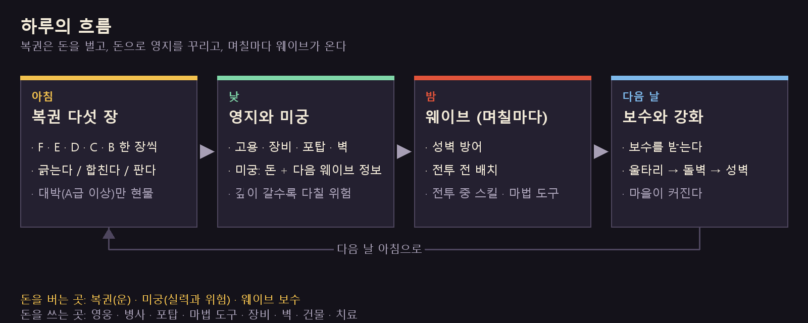
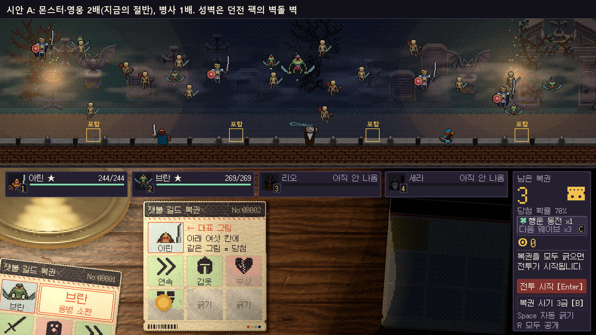
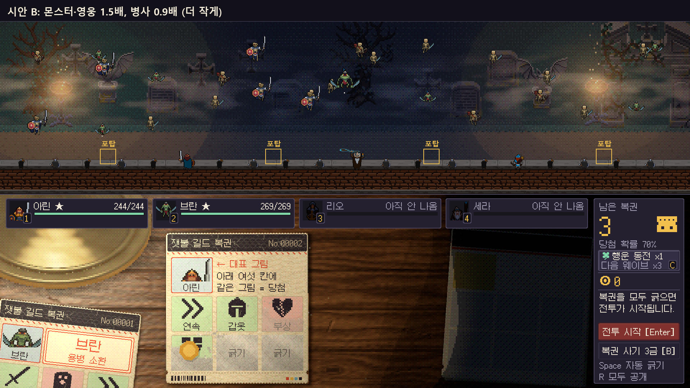

## 왜 바꾸나

지금까지 만든 것은 화면 아래에서 복권을 긁고, 위에서 그 효과로 용병이 싸우는 구조였습니다. 조명과 손맛은 갖춰졌지만 구조에 약점이 하나 있었습니다. **플레이어의 판단이 결과를 바꾸지 못했습니다.**

1,000판 시뮬레이션에서 버프를 받을 용병을 잘 고르는 쪽과 아무에게나 주는 쪽의 승률이 78% 대 77%였습니다. 승패는 어떤 복권이 나왔는가로 갈렸습니다. 판단할 거리를 더 만들 후보를 적어 두고 미뤄 둔 상태였습니다.

여기에 새 구조가 제안됐습니다. 본 웨이브를 성벽 디펜스로 바꾸고, 복권은 돈을 버는 수단으로 돌리는 것입니다.

## 새 구조

- 지구에 살던 주인공이 사고로 판타지 세계에 떨어져 **작은 촌락의 촌장**이 됩니다.
- 가진 능력은 하나입니다. **하루에 복권 다섯 장이 생깁니다.** 판타지 세계에 한국식 즉석 복권이 있는 이유가 여기서 나옵니다.
- 복권을 긁어 **돈**을 벌고, 그 돈으로 영웅과 병사를 고용하고, 포탑을 짓고, 벽을 올립니다.
- 며칠마다 **마물의 웨이브**가 옵니다. 성벽을 두고 위에서 아래로 내려오는 몬스터를 막습니다.
- 돈을 버는 다른 길은 **미궁 탐험**입니다. 지금의 전투를 그대로 씁니다. 탐험하면 다음 웨이브에 올 몬스터를 미리 알 수 있고, 끝에 보상 상자가 있습니다.
- 막고 나면 보수를 받아 영지를 강화합니다. 깎은 나무 울타리에서 돌벽, 성벽으로 올라가고 마을이 커집니다.

{: .shadow }

복권 긁기는 한 씬을 다 쓰게 됩니다. 전투 중에는 긁지 않으므로 눈이 화면 위아래를 오갈 일이 없습니다. 지금까지 만든 나무 테이블, 무드등, 종이 복권, 꽝을 구겨 버리는 손은 그대로 촌장의 방이 됩니다.

## 정한 것

| 정한 것 | 내용 |
|---|---|
| 복권의 등급 | F부터 SSS까지 아홉 단계. 처음의 다섯 장은 F·E·D·C·B가 한 장씩이고, 능력이 자라면 한 칸씩 위로 옮겨 감 |
| 복권에서 나오는 것 | 돈이 기본. A급 이상의 대박만 현물(영웅 계약서, 포탑 설계도, 유물) |
| 전투에서 사람이 하는 일 | 전투 전에 배치하고, 전투 중에 영웅 스킬과 마법 도구를 발동. 자동 진행은 유지 |
| 웨이브 주기 | 5일에서 시작해 시뮬레이션으로 맞춤 |
| 한 영지를 길게 키움 | 지면 처음부터 다시 하는 구조가 아니라, 영지 하나를 오래 키움 |
| 긁기 전의 선택 | 여러 장을 합쳐 한 등급 올리기, 안 긁고 팔기, 행운 동전을 쓸 장 고르기 |
| 바닥 장치 | 등급마다 최소 당첨금 |
| 미궁의 판단 | 얼마나 깊이 들어갈지. 깊이 갈수록 많이 벌지만 다친 용병은 웨이브 날 빠짐. 하루에 한 번 |

"대박만 현물"은 이전에 정한 원칙을 지키려는 것입니다. 이 게임의 묘미는 복권의 효과가 전장에서 실현되는 모습이라고 정해 두었는데, 돈만 나오면 대박의 감정이 "돈이 많다"에서 끝납니다. 대박에서만큼은 성벽 위에 영웅이 서게 합니다.

## 한 영지를 길게 키우기로 한 것

이전에는 로그라이크를 섞기로 했었습니다. 이번에는 영지 하나를 오래 키우는 쪽으로 정해졌습니다. 정리하는 쪽에서는 한 판씩 하고 해금만 남기는 구조를 권했습니다. 수입이 복권이라 판마다 운이 다른데, 한 판이 끝나는 구조면 나쁜 운이 그 판에서 끝나기 때문입니다. 결정은 "내 마을이 커 가는 것"을 택했고, 그래서 긴 저장이 운의 폭을 견디게 하는 규칙을 따로 정했습니다.

- 게임 오버를 두지 않습니다. 웨이브에 져도 영지는 남습니다.
- 지면 벽이 부서지고, 돈의 일부를 빼앗기고, 쓰러진 영웅이 며칠 다칩니다. 마을의 부흥 단계와 지어 둔 건물은 내려가지 않습니다.
- 같은 단계의 웨이브가 다시 옵니다. 막아야 다음 단계로 넘어갑니다.
- 져도 다음 날 아침 복권 다섯 장은 그대로 생깁니다. 다시 일어서는 밑천이 능력 자체입니다.

판마다 달라지는 재미는 미궁 탐험에 둡니다. 들어갈 때마다 층의 구성과 보상이 달라집니다.

## 아직 정하지 않은 것

- 지면 치르는 피해의 크기(수리비, 빼앗기는 돈의 비율, 부상 일수). 시뮬레이션으로 잡습니다.
- 저장 구조. 이전 모바일판의 저장을 넓힐지 새로 만들지입니다.
- 제목. "잿불 용병단"은 촌장 설정과 맞지 않게 됩니다.

## 성벽 방어 시안

공간이 좁아 캐릭터를 작게 그려야 합니다. 얼마나 작게 해도 되는지 구매한 그림을 붙여 정지 화면으로 봤습니다. 움직임과 체력 표시는 없고, 포탑은 그림이 없어 네모로 표시했습니다.

{: .shadow }
_지금의 절반 크기. 몬스터와 영웅이 무엇인지 읽힙니다_

{: .shadow }
_더 줄이면 영웅이 아슬아슬해집니다. 성벽 위의 병사(1배 이하)는 두 시안 모두 검은 덩어리로 보입니다_

몬스터와 영웅은 2배, 병사도 1.5배는 필요하다는 것이 시안의 결론입니다. 구매한 그림 가운데 성기사, 마법사, 도적, 오크, 해골 군단은 위·아래 방향 그림이 있어서, 영웅은 위를 보고 서고 몬스터는 아래로 걸어올 수 있습니다.

## 참고한 것

같은 뼈대를 가진 게임들이 있습니다. 검색 요약으로 확인한 내용입니다.

- [Kingdom Two Crowns](https://www.nerdsandscoundrels.com/kingdom-two-crowns-walls): 비용이 전부 동전이고, 벽이 바리케이드에서 나무, 돌, 성벽, 철로 올라갑니다.
- [The Last Spell](https://store.steampowered.com/app/1105670/The_Last_Spell/): 낮에 영웅의 장비와 방어를 정비하고 밤에 성벽 앞의 몬스터를 막습니다.
- [Dome Keeper](https://shacknews.com/article/132448/dome-keeper-review): 웨이브 사이에 내려가 벌어 옵니다. 얼마나 깊이 갈지가 판단입니다.

웹툰 『디펜스 게임의 폭군이 되었다』도 참고 대상으로 꼽혔습니다. 이 작품은 [게임으로도 만들어지고 있고](https://daily.hankooki.com/news/articleView.html?idxno=1401278), 픽셀 캐릭터로 성을 지킨다는 점이 겹칩니다. 그래서 구조만 참고하고, 앞에 내세울 것은 이 게임만의 것인 "하루 다섯 장의 복권이 영지의 예산이다"로 잡았습니다.

## 다음 단계

화면부터 만들지 않습니다. **방어전의 규칙을 먼저 코드로 쓰고 1,000판을 돌려, 잘 배치하는 쪽과 아무렇게나 두는 쪽의 승률이 벌어지는지를 봅니다.** 이전 구조가 넘어진 자리가 바로 여기였기 때문입니다. 차이가 나지 않으면 화면을 만들기 전에 규칙을 고칩니다.

## 확인한 것과 못 한 것

- 이번에는 기획만 정리했습니다. 게임 코드는 바꾸지 않았습니다.
- 시안은 정지 화면입니다. 움직이는 화면에서 작은 캐릭터가 읽히는지는 아직 모릅니다.
- 참고한 게임들은 검색 요약으로만 봤고, 웹툰과 그 게임은 직접 보지 않았습니다.
- 포탑과 나무 울타리 그림은 구매한 그림에서 찾지 못했습니다.
- 분량이 큽니다. 긁기, 영지 관리, 미궁, 방어전의 네 화면 가운데 영지 관리와 방어전은 새로 만들어야 합니다.
