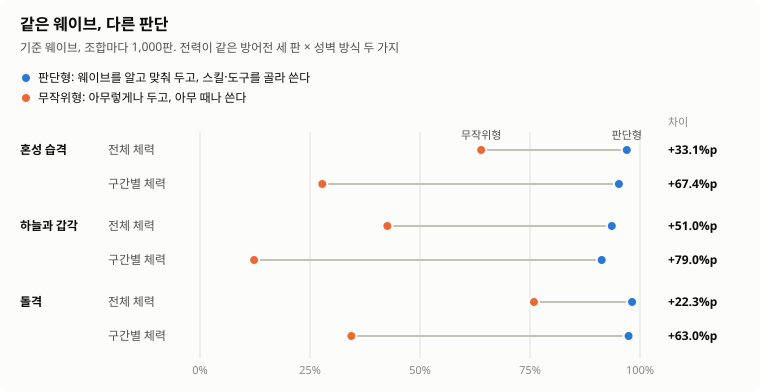
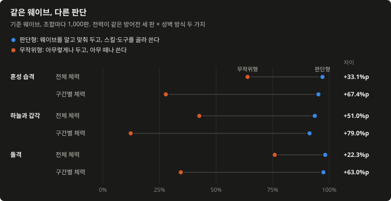
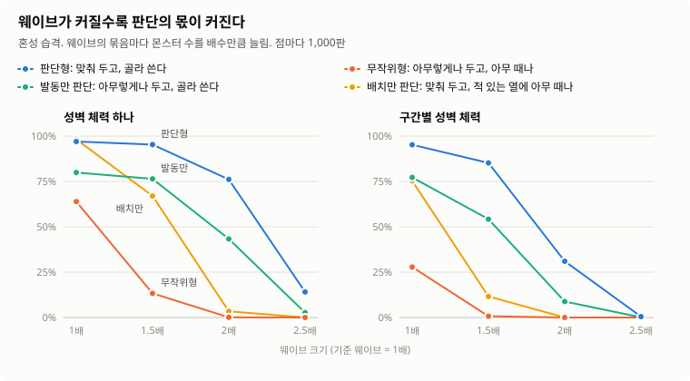
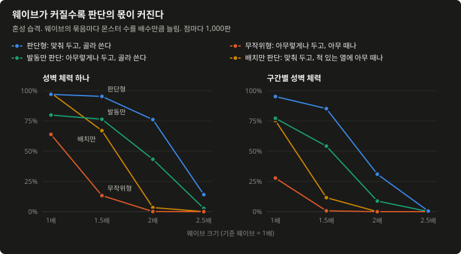
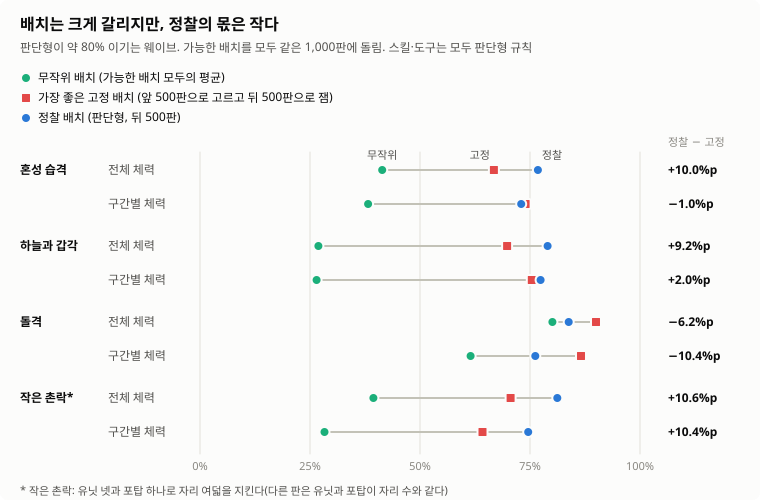
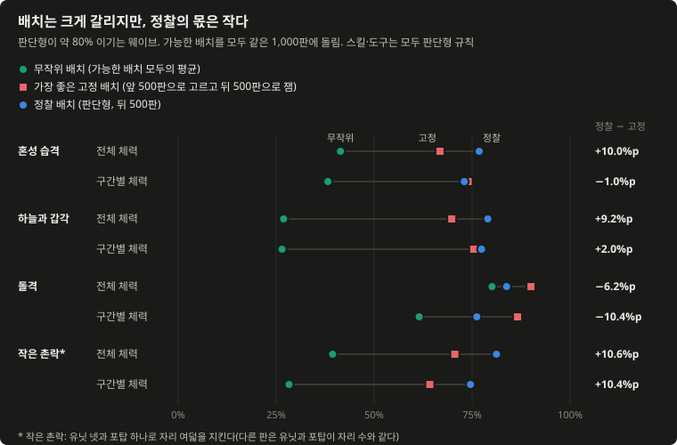

## 왜 화면보다 먼저인가

이전 구조는 1,000판 시뮬레이션에서 플레이어의 판단이 승률을 바꾸지 못했습니다. 버프를 잘 주는 쪽과 아무에게나 주는 쪽이 78% 대 77%였습니다. 그래서 영지 방어로 방향을 바꾸면서 첫 단계를 이렇게 정했습니다. **방어전 규칙을 먼저 짜고, "판단이 승률을 바꾸는지"를 시뮬레이션으로 확인한다. 차이가 없으면 화면을 만들지 않는다.**

방어전에서 사람이 하는 일은 두 가지로 정해져 있습니다. 전투 전에 성벽 위에 누구를 어디 둘지 정하고, 전투 중에 영웅 스킬과 마법 도구를 씁니다. 나머지는 저절로 진행됩니다.

## 한 일

- 방어전 규칙을 Unity를 모르는 코드로 짰습니다. 화면과 씬은 만들지 않았습니다.
- 유닛·스킬·도구·방어전·웨이브를 표 다섯 개에 두었습니다. 몬스터는 미궁에서 만나는 몬스터 표를 그대로 씁니다.
- 모의 플레이어 둘과, 판단을 반씩 나눈 중간 플레이어를 만들어 같은 웨이브에서 견줬습니다.
- 규칙·표·시뮬레이터를 검사하는 테스트 25건을 추가했습니다.

## 규칙

- 몬스터가 화면 위에서 아래로, 여덟 개의 열을 따라 내려와 아래의 성벽을 칩니다.
- 성벽 위에는 열마다 자리가 하나 있습니다. **영웅**(강하고 쿨다운이 있는 스킬), **병사 묶음**(싸고 약함), **포탑**(지어 둔 자리에서 움직이지 않음)이 섭니다. **마법 도구**는 자리에 서지 않는 소모품입니다.
- 유닛은 자기 열과 좌우 1~2열까지, 벽에서 몇 칸까지 닿습니다. 닿는 적 가운데 벽에 가장 가까운 것을 칩니다.
- 몬스터에 종류가 있어야 배치가 의미를 가집니다. **비행**은 대공 유닛만 칠 수 있고, **갑각**은 물리 피해를 40%만 받습니다(강타와 마법은 그대로). **원거리**는 사거리에서 멈춰 성벽 위의 아군을 쏘고, **돌격병**은 한 번에 두 칸을 옵니다.
- 성벽 체력은 두 방식을 비교했습니다. **전체 체력**은 하나의 체력이 0이 되면 집니다. **구간별 체력**은 같은 총량을 자리마다 나누고, 무너진 구간 위의 아군은 쓰러지며, 그 열로 몬스터가 마을에 들어오면 집니다.
- 시드가 정하는 것은 웨이브의 각 묶음이 어느 열로 오는지뿐입니다. 같은 시드와 같은 조작이면 같은 결과가 나옵니다.

## 두 조종사

| 이름 | 배치 | 스킬 · 도구 |
| --- | --- | --- |
| 판단형 | 어떤 몬스터가 어느 열로 오는지 알고, 아직 아무도 맡지 않은 몬스터를 가장 많이 잡을 수 있는 자리에 차례로 둠 | 값어치가 될 때만, 가장 많이 맞는 열에 |
| 무작위형 | 빈 자리에 아무렇게나 | 매 순간 15% 확률로, 아무 열에나 |

판단형의 규칙은 사람이 화면을 보고 따라 할 수 있는 것으로 정했습니다. 최선의 수를 계산하는 것은 아닙니다.

## 결과 1: 판단이 승률을 바꾼다

{: .light }
{: .dark }
_전력이 같은 방어전 세 판, 조합마다 1,000판. 1,000판의 오차는 최대 ±3.1%p_

| 방어전 | 성벽 | 무작위형 | 판단형 | 차이 |
| --- | --- | --- | --- | --- |
| 혼성 습격 | 전체 체력 | 63.9% | 97.0% | +33.1%p |
| 혼성 습격 | 구간별 체력 | 27.8% | 95.2% | +67.4%p |
| 하늘과 갑각 | 전체 체력 | 42.6% | 93.6% | +51.0%p |
| 하늘과 갑각 | 구간별 체력 | 12.3% | 91.3% | +79.0%p |
| 돌격 | 전체 체력 | 75.9% | 98.2% | +22.3%p |
| 돌격 | 구간별 체력 | 34.4% | 97.4% | +63.0%p |

- 두 조종사는 같은 판에서 같은 웨이브를 받습니다. 판끼리 견주면 판단형만 이긴 판이 235~796판, 무작위형만 이긴 판은 6~24판이었습니다.
- 무작위형도 스킬을 판단형만큼 씁니다(혼성 습격에서 한 판에 6.7번 대 6.4번). 차이는 몇 번이 아니라 **언제, 어디에** 쓰느냐에서 납니다.

여기서 끝내면 좋은 결과처럼 보입니다. 그런데 숫자를 더 들여다보니 걸리는 데가 있었습니다.

## 결과 2: 기준 웨이브가 너무 쉽다

{: .light }
{: .dark }
_혼성 습격. 판단을 배치와 발동으로 나눈 중간 조종사 둘을 더했다_

| 성벽 | 조종사 | 1배 | 1.5배 | 2배 | 2.5배 |
| --- | --- | --- | --- | --- | --- |
| 전체 체력 | 무작위형 | 63.9% | 13.3% | 0.1% | 0.0% |
| 전체 체력 | 배치만 판단 | 98.2% | 67.0% | 3.4% | 0.0% |
| 전체 체력 | 발동만 판단 | 79.9% | 76.4% | 43.3% | 2.7% |
| 전체 체력 | 판단형 | 97.0% | 95.3% | 76.1% | 14.1% |
| 구간별 체력 | 무작위형 | 27.8% | 0.7% | 0.0% | 0.0% |
| 구간별 체력 | 배치만 판단 | 75.3% | 11.6% | 0.0% | 0.0% |
| 구간별 체력 | 발동만 판단 | 77.2% | 54.2% | 8.8% | 0.1% |
| 구간별 체력 | 판단형 | 95.2% | 85.2% | 31.0% | 0.5% |

- 기준 웨이브(1배)에서는 판단형이 이긴 판에서 성벽을 95% 이상 남깁니다. 전체 체력에서는 배치만 맞추고 스킬은 적이 있는 열에 아무 때나 써도 판단형과 같습니다(98.2% 대 97.0%). **발동의 판단이 지워져 있습니다.**
- 웨이브를 0.6배로 줄인 돌격전(전체 체력)에서는 판단형과 무작위형의 차이가 +1.2%p로 사라졌습니다(99.3% 대 98.1%).
- 반대로 판단형이 약 80% 이기도록 웨이브를 1.4~1.9배로 키우면, 전력이 같은 세 판에서 무작위형은 0~8%입니다. 가장 큰 몫은 스킬과 도구를 쓰는 때와 자리였습니다.

## 결과 3: 배치는 중요하지만, 정찰의 몫은 작다

기준 웨이브에서 이상한 수치가 하나 있었습니다. **웨이브를 전혀 모르고 유닛의 역할만 보고 둔 배치가, 어느 열로 오는지 아는 배치와 같거나 더 높았습니다.** 기획에서는 미궁을 탐험하면 다음 웨이브의 몬스터를 알 수 있고, 그 정보로 배치한다고 정해 두었습니다. 그 정보가 쓸모없다면 미궁과 방어전을 잇는 고리가 끊깁니다.

배치를 직접 찍어 보니, 역할만 본 배치는 대공 유닛 넷이 여덟 열을 고르게 덮도록 펼쳐지고, 열을 아는 배치는 이번 웨이브가 오는 쪽으로 몰렸습니다. 그래서 웨이브를 키워 둘을 다시 견주고, **가능한 배치를 모두** 같은 1,000판에 돌렸습니다. 유닛 여섯을 빈 자리 여섯에 두는 방법은 360가지입니다.

{: .light }
{: .dark }
_"가장 좋은 고정 배치"는 판마다 바꾸지 않는 배치 하나. 같은 판으로 고르고 재면 부풀려지므로, 앞 500판으로 고르고 뒤 500판으로 쟀다_

| 방어전 | 성벽 | 무작위 배치 | 가장 좋은 고정 배치 | 정찰 배치 | 정찰 − 고정 |
| --- | --- | --- | --- | --- | --- |
| 혼성 습격 | 전체 체력 | 41.4% | 66.8% | 76.8% | +10.0%p |
| 혼성 습격 | 구간별 체력 | 38.2% | 74.0% | 73.0% | −1.0%p |
| 하늘과 갑각 | 전체 체력 | 26.9% | 69.8% | 79.0% | +9.2%p |
| 하늘과 갑각 | 구간별 체력 | 26.5% | 75.4% | 77.4% | +2.0%p |
| 돌격 | 전체 체력 | 80.1% | 90.0% | 83.8% | −6.2%p |
| 돌격 | 구간별 체력 | 61.5% | 86.6% | 76.2% | −10.4%p |
| 작은 촌락 | 전체 체력 | 39.4% | 70.6% | 81.2% | +10.6%p |
| 작은 촌락 | 구간별 체력 | 28.3% | 64.2% | 74.6% | +10.4%p |

- **배치는 승률을 크게 바꿉니다.** 같은 판, 같은 스킬 사용에서 배치만 바꿔도 가장 나쁜 것과 가장 좋은 것이 30~70%p 차이 납니다.
- **그런데 정찰한 웨이브에 맞춘 배치가 가장 좋은 고정 배치를 이긴 것은 여섯 경우 중 둘(+9~10%p)뿐입니다.** 돌격처럼 넓게 오는 웨이브에서는 정찰 배치가 한쪽으로 몰려 오히려 졌습니다. 유닛이 자리 수만큼 있고 좌우로 1~2열씩 닿으니, 넓게 펼친 진형 하나로 거의 다 막힙니다. 한 번 좋은 진형을 익히면 미궁의 정보 없이도 거의 같은 결과가 나온다는 뜻입니다.
- **유닛이 자리보다 적은 작은 촌락에서는 정찰 배치가 두 성벽 방식 모두 약 +10%p 높습니다.** 다 덮을 수 없으니 어느 열을 비울지가 판단이 됩니다.
- 판마다 결과를 보고 가장 좋은 배치를 고르면 거의 모든 판(96~100%)을 이깁니다. 웨이브 정보에는 큰 여지가 있고, 판단형의 단순한 규칙은 그 일부만 씁니다. 사람이 그보다 잘 두는지는 아직 모릅니다.
- 어떤 몬스터가 오는지만 알고 어느 열인지 모르면, 모든 열이 똑같아 보여서 배치에 쓸 데가 없었습니다. 이 조종사는 매번 같은 고정 배치를 하나 만드는 것과 같았고, 역할만 본 배치보다 승률이 낮았습니다.

## 성벽 체력: 하나로, 자리마다

- 같은 총 체력이면 구간별이 훨씬 어렵습니다. 혼성 습격에서 무작위형은 64%에서 28%로 떨어지고, 판단형은 97%에서 95%로 거의 그대로입니다. 아무렇게나 둔 배치를 더 크게 벌합니다.
- 판단형이 80% 이기도록 난이도를 맞추면 판단형과 무작위형의 차이는 전체 체력 +76~86%p, 구간별 +73~80%p로 비슷합니다. **판단의 크기로는 둘 중 하나를 고를 근거가 없습니다.**
- 기획에는 "웨이브에 지면 뚫린 곳의 벽이 부서져 수리비가 든다"는 규칙이 있습니다. 어디가 뚫렸는지가 있어야 성립하는 규칙이라 구간별을 제안해 두었습니다. 결정은 아직입니다.

## 판단을 지우는 것과 고칠 후보

| 판단을 지우는 것 | 고칠 후보 |
| --- | --- |
| 웨이브가 전력에 비해 약하다 | 기준 웨이브를 키운다. 판단형이 70~90% 이기는 크기가 1.4~1.9배 근처 |
| 유닛 수가 자리 수와 같고 사거리가 넓어 진형 하나로 다 덮인다 | 유닛을 자리보다 적게 시작한다. 또는 사거리를 줄이거나, 몬스터를 몇 열에 몰아 보낸다 |
| 종류만 알려 주는 정보는 배치에 쓰이지 않는다 | 미궁에서 몬스터의 종류와 함께 **어느 쪽으로 오는지**를 알려 준다 |

## 확인한 것

- 새 테스트 25건(규칙 15, 표 5, 시뮬레이터 5)을 포함해 Unity EditMode 테스트 629건이 모두 통과했습니다.
- 같은 시드는 같은 웨이브와 같은 결과를 냅니다. 표의 수치를 바꾸면 규칙이 바뀌고, 잘못된 행은 표·행·열로 알려 줍니다.
- 위의 승률은 모두 화면 없는 실행 환경에서 규칙 코드를 그대로 돌린 모의 플레이어의 결과입니다. **사람이 해 본 검증은 아직 없습니다.** 화면이 없기 때문입니다.
- 출시 표의 수치를 결과에 맞춰 고치지 않았습니다. 고치는 중간에 판단형의 배치 규칙을 한 번 고쳤는데, 승률을 올리려던 것이 아니었고 실제로도 조금 내려갔습니다.

## 확인하지 못한 것

- 사람이 미궁의 정보를 보고 판단형 규칙보다 잘 두는지 모릅니다.
- 무작위형의 "아무 때나"는 매 순간 15%로 정한 값입니다. 이 값이 바뀌면 무작위형의 승률도 바뀝니다.
- 10,000판은 돌리지 않았습니다. ±3%p보다 작은 차이는 가릴 수 없습니다.
- 지면 벽 피해가 다음 웨이브로 이어지는 것은 이번 범위가 아닙니다. 한 번의 방어전만 쟀습니다.

## 다음

- 성벽 방식, 유닛과 자리의 수, 미궁이 알려 줄 정보를 정합니다.
- 기준 웨이브를 판단형이 70~90% 이기는 크기로 다시 잡습니다.
- 방어전 한 판의 화면(V1)을 만들어 사람이 해 보고, 판단형 규칙과 사람의 배치를 견줍니다.


