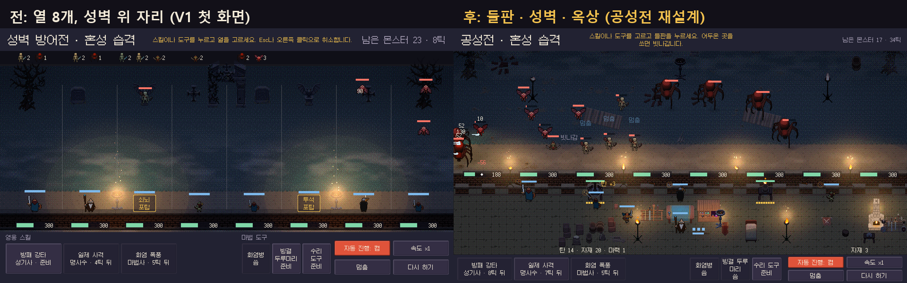
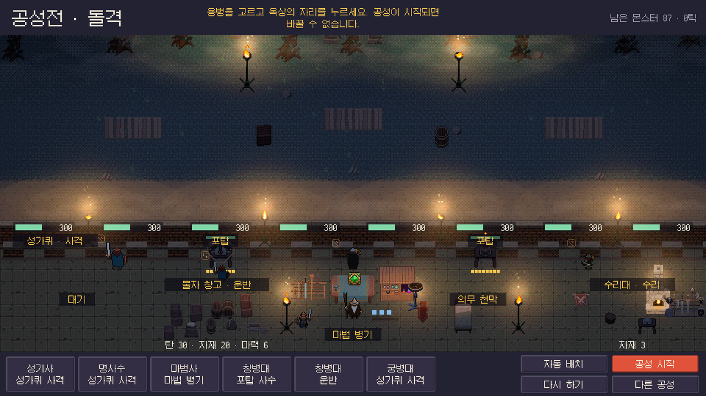
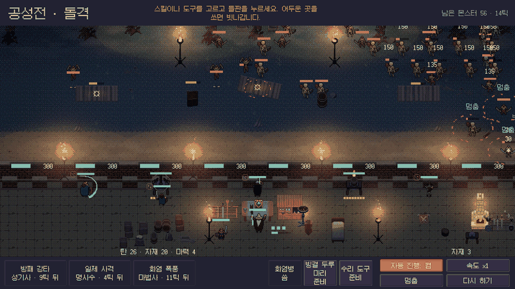

## 받은 지적

[방어전 규칙](/posts/defense-v0-simulation/)으로 첫 화면을 만들었습니다. 몬스터가 여덟 개의 열을 따라 내려오고, 성벽 위 여덟 자리에 영웅과 병사가 서는 화면입니다. 그 화면을 보고 받은 지적은 이렇습니다.

- 공성이 시작되면 유닛을 더 배치할 수 없어야 한다.
- 몬스터가 정해진 레일로만 오는 건 재미가 없다.
- 오는 길에 구조물이 있고 횃불 같은 것이 잔잔하게 비춰야 한다. 몬스터는 그것들을 부술 수 있다.
- 용병이 성벽 위에 서 있는 게 아니라, **성 옥상**에서 물자를 나르고, 포탑을 쓰고 고치고, 마법 병기를 돌리고, 다친 동료를 치료하고, 성벽을 고치는 모습이어야 한다.
- 지금 모습은 너무 정적이다.

네 가지를 물어 정했습니다.

| 물은 것 | 고른 답 |
|---|---|
| 용병의 일은 언제 정하나 | 공성 전에 정하고, 시작하면 각자 알아서 일한다 |
| 몬스터는 어디로 오나 | 길 없이 들판 어디로든 |
| 구조물은 어디서 오나 | 지도에 놓인 것 + 영지에서 사서 설치하는 것 |
| 횃불은 무슨 뜻인가 | 어두운 곳을 쏘면 빗나간다 |

{: .shadow }

## 규칙부터 다시

[이 프로젝트의 순서](/posts/defense-v0-simulation/)대로 화면보다 규칙을 먼저 짰습니다. Unity를 모르는 코드로 짜고 시뮬레이션으로 확인했습니다.

- **들판:** 가로는 성벽 폭(8), 세로는 성벽까지의 거리(6)인 연속 좌표입니다. 몬스터는 위쪽 가장자리 아무 데서나 나옵니다. 그리고 나온 자리에서 조금 옆의 성벽 지점을 각자 골라 비스듬히 걸어옵니다. 열은 없습니다.
- **구조물:** 울타리·상자·통은 길을 막습니다. 몬스터는 닿은 곳에서 멈춰 부숩니다. 함정은 밟으면 터집니다. 빠른 몬스터가 한 걸음에 건너뛰지 못하게, 이동을 점이 아니라 선분으로 판정합니다.
- **빛:** 한 점의 밝기는 약한 달빛, 살아 있는 횃불·화로, 성벽에 박힌 횃불을 더한 값입니다. 사격의 명중은 `0.35 + 0.65 × 밝기`입니다. 박쥐 같은 날짐승은 가까운 횃불부터 노립니다.
- **옥상의 일 여섯 가지:** 성가퀴에서 직접 쏘기, 포탑 쏘기(탄을 씀), 마법 병기 돌리기(마력 결정을 씀), 창고에서 탄·마력·자재 나르기, 성벽과 포탑 고치기(자재를 씀), 다친 동료 치료하기.
- **사람이 하는 일:** 공성 전에 용병마다 일을 정합니다. 공성 중에는 영웅 스킬과 마법 도구를 들판의 한 점에 씁니다.

## 판단이 결과를 바꾸는가

모의 플레이어 둘을 지도마다 1,000판씩 돌렸습니다(자동 입력 시뮬레이션이며 사람 플레이가 아닙니다).

- **판단형:** 일을 잘 나누고, 스킬은 몬스터가 몰린 곳에 씁니다.
- **무작위:** 일을 아무렇게나 정하고, 스킬은 아무 데나 씁니다.

| 지도 | 판단형 | 무작위 | 스킬만 잘 씀 |
|---|---|---|---|
| 혼성 습격 | 91.1% | 0.0% | 9.4% |
| 하늘과 갑각 | 84.3% | 0.2% | 11.6% |
| 돌격 | 95.3% | 0.0% | 11.1% |
| 작은 촌락 | 76.3% | 12.3% | 28.3% |

들판에 놓인 것을 하나씩 빼 보면, 각각이 결과를 바꿉니다(혼성 습격, 판단형).

| 뺀 것 | 승률 |
|---|---|
| 없음 | 91.1% |
| 횃불 전부 | **22.4%** |
| 막는 구조물 | 60.8% |
| 함정 | 87.9% |
| 짐꾼 (사수로 돌림) | 21.5% |
| 마법 병기 (사수로 돌림) | 56.2% |

빛이 가장 큰 레버입니다. 그래서 박쥐가 횃불을 끄면 실제로 위험해집니다.

## 수리공과 의무병이 할 일이 없었다

일자리 조합을 전부 돌려 봤더니, 수리공이나 의무병을 넣은 조합은 오히려 졌습니다(그때의 웨이브로 혼성 습격에서 넣으면 최고 72%, 빼면 87%). 원인을 따라가 보니, 성벽에 닿은 몬스터가 **매 틱** 쳐서 구간이 순식간에 무너지고 있었습니다. 고칠 틈이 없었습니다.

- 몬스터는 두 틱에 한 번 치게 했습니다.
- 수리공은 무너진 구간도 막고, 의무병은 쓰러진 용병을 일으키게 했습니다.

이제 갑각 괴수가 성벽을 오래 두드리는 지도(하늘과 갑각)에서는 수리공을 넣은 조합이 89%, 뺀 조합이 84%입니다. 의무병은 아직 손해입니다. 원거리 몬스터가 적은 지금 지도에서는 다치는 용병이 드뭅니다. 원거리 몬스터가 많은 지도를 만들지, 의무병의 몫을 바꿀지는 정하지 않았습니다.

중간에 집계 버그도 하나 있었습니다. 지도 표에 열을 하나 넣은 뒤로 "구조물 빼기" 도구가 엉뚱한 열을 지우고 있었습니다. "막는 구조물 없음"이 원래와 똑같이 나와서 데이터 경로부터 확인하다 찾았고, 고친 뒤 다시 쟀습니다.

## 화면: 들판, 성벽, 옥상

{: .shadow }

- **들판:** 횃불과 화로마다 빛 웅덩이를 그립니다. 웅덩이 크기는 규칙의 밝기 범위와 같은 비율이라, 화면에서 밝아 보이는 곳이 규칙에서도 밝은 곳입니다. 횃불이 꺼지면 연기가 오르고 그 둘레가 어두워집니다. 상자와 통은 구매한 던전 팩에 들어 있는 부서지는 프레임대로 깨지고, 울타리는 넘어갑니다.
- **성벽:** 구간마다 체력 막대가 있습니다. 깎이면 흠집이 늘고, 무너지면 잔해와 연기가 남습니다.
- **옥상:** 마을 팩의 상자·통·자루로 물자 창고를, 마법사 탁자로 마법 병기를, 모루와 용광로로 수리대를 꾸몄습니다. 포탑 그림은 사지 않아서, 숫돌 위에 활과 볼트(쇠뇌), 통과 불씨(투석)를 얹어 임시로 만들었습니다.
- **일하는 모습:**
  - 짐꾼은 짐을 들고 포탑·병기·수리대까지 걸어가 "+3"을 내려놓고 돌아옵니다. 탄은 상자, 마력은 약병, 자재는 자루입니다.
  - 수리공은 고칠 구간까지 걸어가 망치질합니다.
  - 의무병은 다친 동료에게 갑니다.
  - 사수는 화살을 날리고, 어두운 곳을 쏘면 "빗나감"이 뜹니다.
- **배치:** 아래의 용병 카드를 고르고 옥상의 자리를 누르면 그 일을 맡습니다. "공성 시작"을 누른 뒤에는 바꿀 수 없습니다.

{: .shadow }

## 검증

- 규칙 테스트 19건을 새로 넣었습니다. Unity EditMode 전체 **670/670 통과**입니다.
- 화면은 지도 셋, 시드 다섯으로 Play에서 배치 → 공성 → 결과까지 오류 없이 돌았습니다. 자동 입력으로 확인한 것이며 사람 플레이 검증은 아닙니다.

## 아직 안 한 것

- 사람이 해 보기. 두 번 클릭으로 일을 정하는 흐름이 읽히는지, 한 판 30초쯤이 짧지 않은지.
- 몬스터가 장애물을 돌아가는 것(지금은 부순다).
- 영지에서 구조물을 사서 설치하는 것.
- 영지 경제를 새 공성 규칙으로 다시 재는 것.
