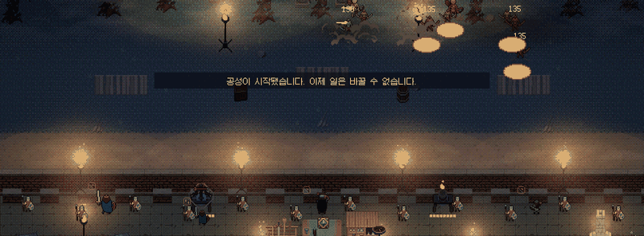
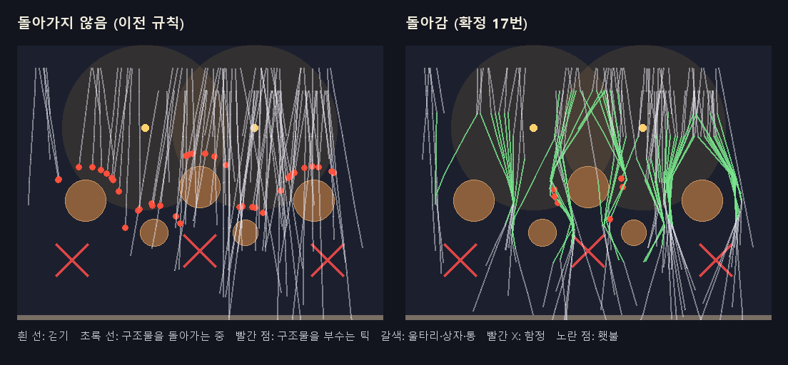
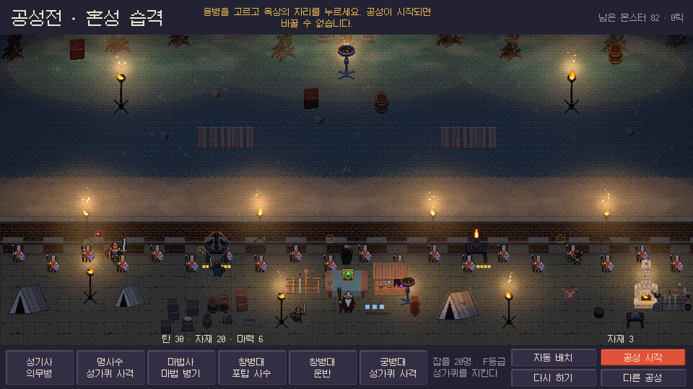

## 받은 주문

[옥상 시점 공성전](/posts/siege-rooftop/)을 만든 뒤에 받은 주문입니다.

- 몬스터가 장애물을 피해야 한다(그때 정하고 못 한 것).
- 몬스터가 한 번에 훅훅 움직이는 게 별로다. 천천히 걸어와야 한다.
- 오브젝트들은 ID, 힘, 스피드, 체력, 마력, 공격속도를 가져야 한다.
- 침대보다 A형 텐트 막사. 성 위에 잡졸 병사가 바글바글해야 한다. 성을 지키는데 병사가 너무 조촐하다. 잡졸은 F등급.
- 체력 막대는 다 빼자. 성벽도.

{: .shadow }

(이 GIF는 잡졸이 12명이던 때 찍었습니다. 지금 표는 20명입니다.)

## 돌아갈까, 부술까

몬스터마다 이렇게 정합니다.

- 성벽의 자기 지점까지 가는 직선에서, 가까이(1.5 안) 있는 첫 번째 막는 구조물을 본다.
- 그 옆에 지나갈 틈이 있는지 본다. 들판 안이어야 하고 다른 구조물에 닿지 않아야 한다.
- 돌아가는 데 더 걸리는 시간이 부수는 데 걸리는 시간보다 짧으면 돌아간다. 아니면 다가가서 부순다.

지금 수치로는 돌아가는 편이 거의 늘 빠릅니다. 울타리(체력 300)를 해골이 부수면 14틱, 돌아가면 1틱 안팎입니다. 그래서 몬스터는 틈이 없을 때만 부숩니다.

{: .shadow }

위 그림은 규칙 코드가 틱마다 남긴 좌표를 그대로 그린 것입니다. 초록 선이 돌아가는 구간, 빨간 점이 구조물을 부수는 틱입니다. 돌아가기를 켜면 같은 판에서 80번 돌아갑니다.

구조물이 쓸모없어진 것은 아닙니다. 지도마다 1,000판씩 돌렸습니다(모의 조종사이며 사람 플레이가 아닙니다).

| 뺀 것 (판단형) | 혼성 습격 | 돌격 | 하늘과 갑각 |
|---|---|---|---|
| 없음 | 86.4% | 90.2% | 85.7% |
| 막는 구조물 | 60.4% | 78.6% | 86.8% |
| 함정 | 82.3% | 79.1% | 78.5% |

울타리를 줄지어 둔 두 지도에서는 여전히 값을 합니다. 몬스터가 틈으로 몰리고, 그 틈 옆의 함정을 밟습니다. 구조물을 흩어 놓은 지도(하늘과 갑각)에서는 값이 없어졌습니다. 다음에 만들 "영지에서 구조물을 사서 설치하기"에서는 틈을 어디에 두느냐가 판단이 되어야 합니다.

## 같은 능력치를 가진 오브젝트

몬스터, 용병, 포탑, 구조물이 모두 같은 묶음을 갖습니다. 표의 ID, 판 안의 고유 번호, 체력, 힘, 스피드, 공격속도, 마력입니다. 해당 없는 값은 0입니다(울타리는 걷지도 치지도 않습니다).

- 전에는 "몬스터는 두 틱에 한 번 친다"가 규칙 표의 값 하나였습니다. 이제 몬스터마다의 공격속도(0.5)입니다.
- 스피드는 몬스터에게는 걷는 거리, 용병에게는 옥상 일의 빠르기입니다.
- 영웅 스킬의 대기 시간은 마력으로 바뀌었습니다. 스킬이 마력을 쓰고, 틱마다 조금씩 찹니다.

구조를 바꿀 때는 결과가 바뀌면 안 됩니다. 값을 전과 같게 두고 시뮬레이션 63줄을 다시 돌려서, 승률을 포함한 여섯 열이 모두 전과 같은 것을 확인한 뒤에 다음으로 넘어갔습니다.

## 성 위의 잡졸

{: .shadow }

- F등급 잡졸(체력 90, 힘 8)이 성가퀴에 20명 섭니다. 고용한 용병과 따로이고, 일을 정하지 않습니다.
- 넣자마자 판단형 승률이 94~99%가 돼서 웨이브를 키웠습니다. 지금은 판단형 77~90%, 무작위 0~18%입니다. 잡졸을 모두 빼면 36~62%로 떨어집니다.
- 일자리의 몫도 바뀌었습니다. 수리공이 네 지도 모두에서 가장 좋은 조합에 듭니다(전에는 한 지도뿐). 반대로 포탑에 사람을 두는 것은 큰 지도 셋에서 손해가 됐습니다. 의무병은 여전히 손해입니다. 둘 다 아직 정하지 않았습니다.
- 그림: 잡졸은 구매한 NPC 팩의 보초병입니다. A형 텐트는 가진 팩 17개에 없어서 코드로 그린 임시 그림입니다(64×44 픽셀). 팩을 사면 바꿉니다.

체력 막대는 모두 뺐습니다. 성벽은 흠집과 잔해로, 나머지는 움직임과 쓰러짐으로 보입니다. 걸음은 한 틱 내내 같은 빠르기로 이어지게 바꿨습니다(전에는 틱마다 미끄러졌다 멈췄습니다).

## 버그인 줄 알았던 검은 얼룩

캡처 132장 중 2장에서 몬스터 발밑에 순수한 검은 타원이 보였습니다. 한 프레임만 나오고 사라집니다.

- 그림자, 빛 번쩍임, 효과 그림을 하나씩 따로 불러서 효과 그림이 원인인 것을 찾았습니다.
- 같은 효과를 느리게 재생해 보니 둘째 프레임에서만 검게 나왔습니다.
- 원본 PNG를 열어 보니 그 프레임이 원래 검은 타원이었습니다(불투명 84픽셀이 모두 검정). 폭탄이 떨어지는 자리를 알리는 착탄 표시입니다.

버그가 아니라 원래 그림이었습니다. 다만 화염 폭풍이 여러 몬스터를 한꺼번에 맞히는 밤 들판에서는 얼룩으로 보여서, 이 화면에서는 앞의 세 프레임을 건너뛰고 폭발부터 재생합니다. 원본은 그대로 뒀습니다.

## 검증

- 규칙 테스트를 8건 더했습니다(공성전 27건). dotnet에서 74/74 통과입니다.
- Unity EditMode는 잡졸이 12명이던 때 678/678 통과였습니다. 마지막 표로 다시 돌린 실행은 682건 중 679건 통과이고, 실패 3건은 같은 작업 폴더에서 따로 진행 중이던 타이틀 화면 작업의 것입니다. 공성전 테스트는 모두 통과했습니다.
- 화면은 Play에서 두 지도를 배치부터 공성 25틱까지 자동 입력으로 돌려 캡처했습니다. 사람 플레이 검증은 아닙니다.

## 아직 안 한 것

- 사람이 해 보기. 걸음이 원하던 느낌인지, 체력 막대 없이 성벽 상태가 읽히는지.
- 포탑 사수와 의무병의 몫.
- 영지에서 구조물을 사서 설치하기, 영지 경제를 새 공성 규칙으로 다시 재기.
