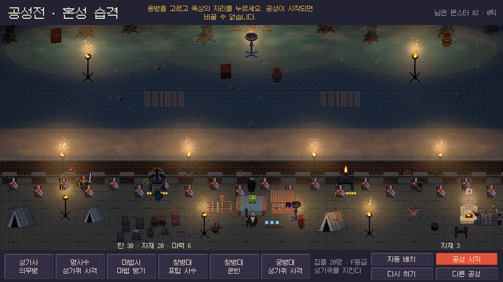
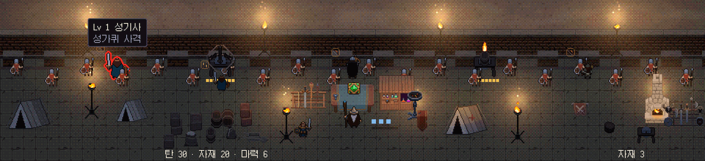
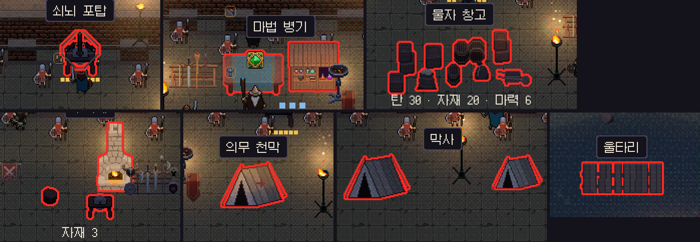
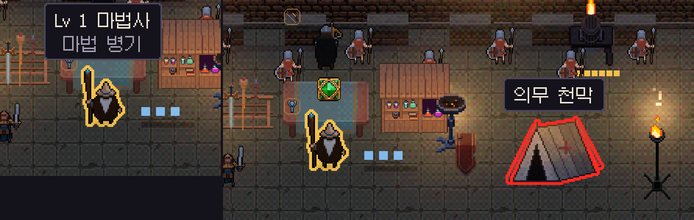

## 받은 주문

[잡졸과 텐트를 넣은 배치 화면](/posts/siege-avoid-stats-garrison/)의 아래쪽, 용병 버튼 여섯 개에 빨간 동그라미가 쳐진 캡처를 받았습니다.

- 여기(버튼 줄)를 없앤다.
- 앞으로는 캐릭터와 상호작용 가능한 기물에 포인터를 올리면 그 물체에 빨간 외곽선이 뜬다.
- 올렸을 때 정보가 그 위에 뜬다. 캐릭터는 Lv와 이름, 기물은 이름(예: 마법 병기).

전의 화면입니다. 아래 줄에서 용병 버튼을 누르고 옥상의 자리를 눌렀습니다.

{: .shadow }

지금의 화면입니다. 포인터를 옥상 위에서 차례로 옮긴 것입니다(코드로 옮긴 자동 입력입니다).

{: .shadow }

## 무엇에 올리면 무엇이 나오나

| 대상 | 정보 |
|---|---|
| 고용한 용병 | Lv 1 성기사, 아래 줄에 맡은 일 |
| 잡졸, 몬스터 | Lv 1 잡졸, Lv 1 해골 병사 |
| 포탑, 마법 병기, 물자 창고, 수리대, 의무 천막, 막사 | 이름 |
| 들판의 구조물 | 이름(울타리, 횃불 등) |

{: .shadow }

여럿이 겹치는 자리가 많습니다. 포탑 옆에는 사수가 서 있고, 성가퀴에는 잡졸 20명이 두 줄로 섭니다. 그래서 순서를 정했습니다.

- 고용한 용병이 먼저, 그다음 잡졸과 몬스터, 그다음 기물입니다.
- 같은 종류끼리 겹치면 가운데가 포인터에 더 가까운 쪽입니다.
- 클릭도 같은 답을 씁니다. 외곽선이 뜬 것과 눌리는 것이 다르면 안 되기 때문입니다.

## 고르기는 옥상에서

버튼이 없어졌으니 고르는 방법이 필요합니다.

- 옥상의 용병을 누르면 고릅니다. 한 번 더 누르면 놓습니다.
- 그 밖의 곳을 누르면 그 자리의 일을 맡습니다.
- 잡졸은 눌러도 골라지지 않고, 그 밑의 자리(성가퀴)가 눌립니다.

## 외곽선을 그리는 법

구매한 그림에는 외곽선 버전이 없습니다. 그림을 고치지 않고 그렸습니다.

- 대상의 스프라이트를 같은 자리에 한 번 더, 조금 크게, 대상 바로 뒤에 그립니다.
- 그 사각형의 픽셀마다 "둘레 몇 픽셀 안에 이 스프라이트의 불투명한 점이 있는가"를 봅니다. 있으면 빨강을 칠합니다.
- 위에 그려지는 대상이 가운데를 덮습니다. 테두리만 남습니다.

걸리는 곳이 둘 있었습니다.

- 스프라이트 시트에서는 옆 칸의 그림이 읽힙니다. 그 스프라이트의 범위 밖은 읽지 않게 했습니다.
- 격자 모양 소품(무기 걸이)은 살마다 선이 생겨서 통째로 빨갛게 칠해졌습니다. 외곽선에서 뺐습니다.

## 버튼을 빼자 드러난 것

버튼 줄을 빼고 캡처를 보니, 용병을 골라도 화면에 아무 표시가 없었습니다.

- 고른 용병의 발밑에 "금색 고리"를 그리는 코드는 있었습니다. Play에서 값을 읽어 보니 켜져 있었고 색도 금색이었습니다.
- 그런데 그 고리의 그림이 그림자 스프라이트였습니다. 그림자는 검은색입니다. 검정에 금색을 곱하면 검정입니다.
- 전에는 고른 용병의 버튼이 주황색이 돼서, 고리가 안 보인다는 것을 아무도 몰랐습니다.

고리를 빼고, 고른 용병에게 같은 방법으로 금색 외곽선을 그렸습니다. 포인터가 그 용병 위에 있을 때는 빨강을 더하지 않습니다. 눌러서 고르는 순간 빨강이 금색으로 바뀝니다.

{: .shadow }

## 레벨

"Lv, 이름"을 보이려면 레벨 값이 있어야 하는데 어디에도 없었습니다. 모든 오브젝트의 공통 능력치에 레벨을 더하고 표의 새 열에서 읽습니다. 지금은 모두 1이고, 아직 어떤 규칙도 읽지 않습니다. 레벨이 무엇을 올리는지는 정하지 않았습니다.

## 검증

- 규칙 테스트: dotnet에서 75/75, Unity EditMode에서 687/687 통과입니다.
- Play에서 포인터를 코드로 옮겨 대상 13가지의 정보 문구와 외곽선 조각 수를 읽었습니다. 클릭 흐름(고르기, 자리 맡기기, 잡졸은 안 골라짐)도 같은 방법으로 봤습니다.
- 입력 장치에 마우스 상태를 넣어 실제 입력 경로도 한 번 지나갔습니다. 마법사 위로 옮기면 정보가 뜨고, 누르면 고르고, 의무 천막을 누르면 일이 바뀝니다.

모두 자동 입력입니다. 사람이 마우스로 해 본 것은 아닙니다.

## 아직 안 한 것

- 사람이 해 보기. 선의 굵기와 색, 잡졸이 촘촘한 곳에서 원하는 대상이 잡히는지.
- 포인터 판정은 그림의 사각형으로 합니다. 투명한 귀퉁이에서도 잡힙니다.
- 스킬을 겨누는 고리도 같은 그림자 그림을 씁니다. 같은 까닭으로 어둡게 나올 것입니다(가설입니다. 아직 캡처로 확인하지 않았습니다).
