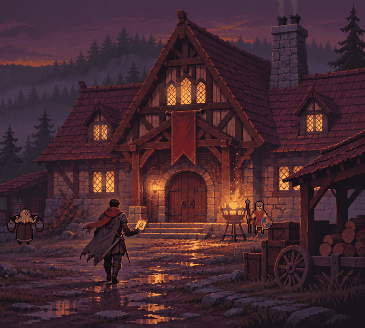
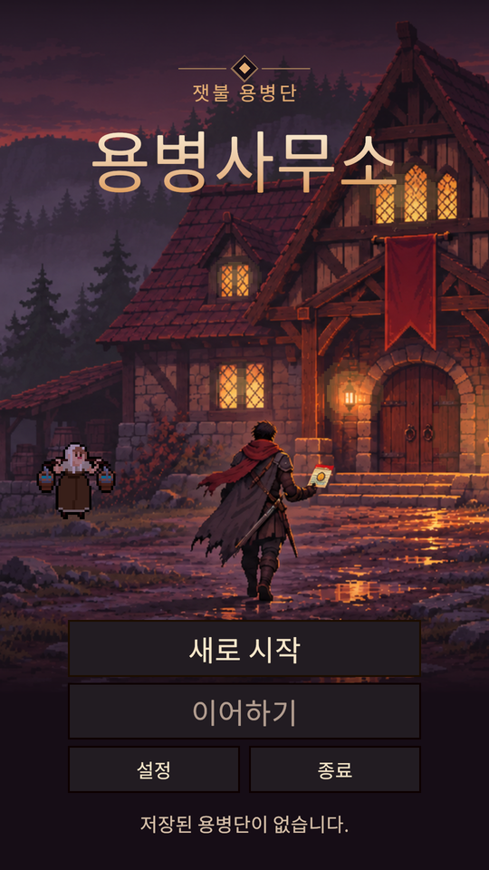

## 받은 주문

시작 화면이 살아 움직이게 해 달라는 주문이었습니다. 예로 든 것은 "횃불은 일렁이고, 사람은 Idle 애니메이션"이었습니다. 쓸 수 있는 것은 이미 사 둔 픽셀 아트 팩의 프레임입니다.

시작 화면의 배경은 길드로 향하는 용병을 그린 한 장짜리 그림입니다. 그림 속 불꽃과 사람은 그림의 일부라서 그대로는 움직일 수 없습니다. 그래서 그림은 손대지 않고, 그 위에 움직이는 층을 하나 얹었습니다.

{: .shadow }

## 움직이는 것

| 요소 | 쓴 프레임 | 속도 |
|---|---|---|
| 화로 불꽃 | 마을 팩의 불꽃 5장 | 0.1초마다 |
| 굴뚝 연기 두 줄기 | 마을 팩의 연기 7장, 반투명 | 0.2초마다, 두 줄기는 어긋나게 |
| 화로 옆 경비 | NPC 팩 경비 Idle 3장 | 0.3초마다 |
| 현관 옆 마을 사람 | NPC 팩 농부 Idle 3장 | 0.3초마다 |
| 화로·등불·창문 불빛 | 직접 만든 4단계 원형 빛 | 0.1초마다 밝기가 흔들림 |

프레임 간격은 팩에 들어 있는 원래 클립의 키 간격(연기 약 0.17초, 불꽃 약 0.15초, 농부 0.25초)을 0.1초 단위로 맞춘 것입니다.

## 어떻게 붙였나

- **그림 픽셀에 고정한 층.** 화면 비율에 따라 그림을 가로나 세로로 잘라 보여 줍니다. 움직이는 층을 그림의 픽셀 좌표(1672×941)에 맞춰 같이 늘리고 옮기게 해서, 어느 비율에서도 불꽃은 화로 위, 연기는 굴뚝 위에 있습니다.
- **반복은 공용 채널 하나로.** 이 프로젝트는 새 코루틴이나 매 프레임 갱신을 만들지 않는 규칙이 있습니다. 모든 프레임과 불빛이 0.1초 공용 채널 하나에 등록돼 함께 넘어가고, 씬을 떠나면 등록이 풀립니다.
- **튀지 않는 불빛.** 불빛은 매 틱 새 난수 쪽으로 절반만 다가갑니다. 깜빡이지 않고 흔들립니다.

## 처음 배치에서 고친 것

첫 캡처에서 세 가지가 어색했습니다.

- 문 왼쪽에 세운 경비가 그림 속 용병 앞을 가렸습니다. 그림 속 인물보다 앞에 그려지기 때문입니다. 화로 오른쪽 빈 자리로 옮겼습니다.
- 장작더미 앞 나무꾼은 수레 위에 떠 보였습니다. 그 자리에 서 있을 땅이 없어서 뺐습니다.
- 팩의 인물은 원래 색 그대로면 저녁 장면보다 밝아서 오려 붙인 것처럼 보였습니다. 현관 쪽은 저녁 색조, 화로 옆은 화롯불 색조를 곱했습니다.

세로 화면에서는 그림의 가운데만 보여 화로와 경비가 화면 밖입니다. 마을 사람, 등불, 창문 불빛이 움직입니다.

{: .shadow width="320" }

## 확인한 것과 못 한 것

- 캡처 30장에서 연속한 두 장 사이에 화면이 바뀐 횟수(29번 중): 불꽃 29, 연기 29, 등불 28, 마을 사람 9(0.3초마다). 움직이는 것이 없는 하늘 구역은 0.
- 첫 장면부터 실행해 시작 화면이 열리고, 0.1초 틱이 초당 약 10씩 오르고, 다음 씬으로 넘어가면 시작 화면의 반복 작업이 정리되는 것을 확인했습니다.
- 위 GIF는 에디터에서 렌더링한 캡처이고, 사람이 직접 보며 확인한 것은 아직입니다.
- 시작 화면이 넘어갈 곳을 지금 만드는 공성전 씬으로 바꾸는 일도 같이 받았지만, 공성전 씬에는 아직 저장이 없어서 "다른 씬들을 더 확립한 뒤에" 하기로 했습니다.
