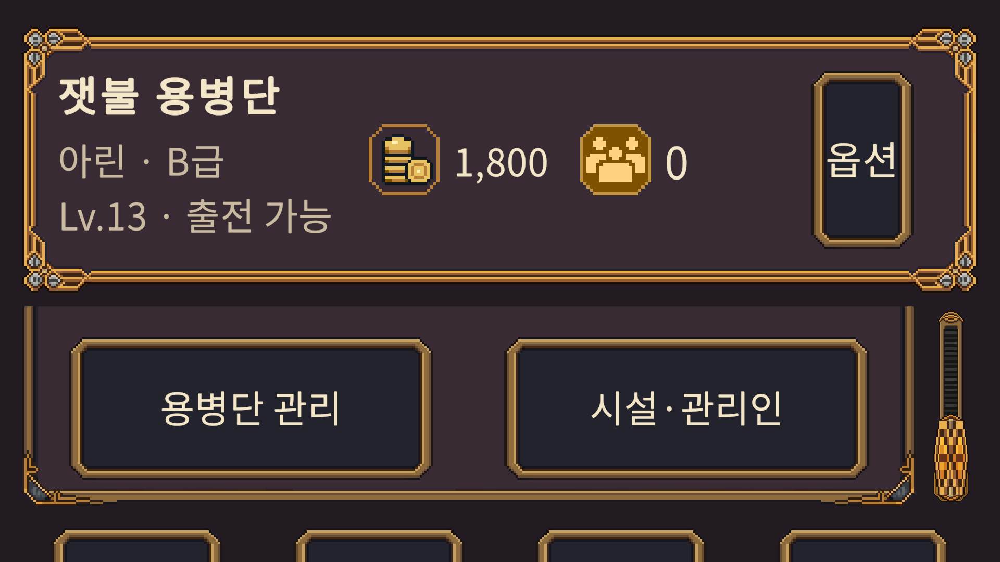
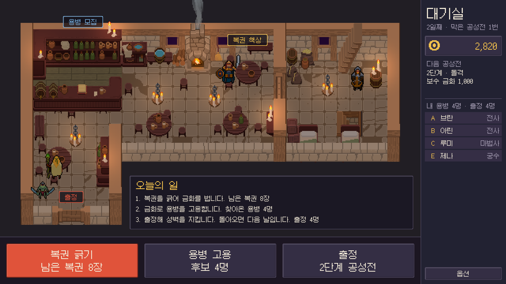
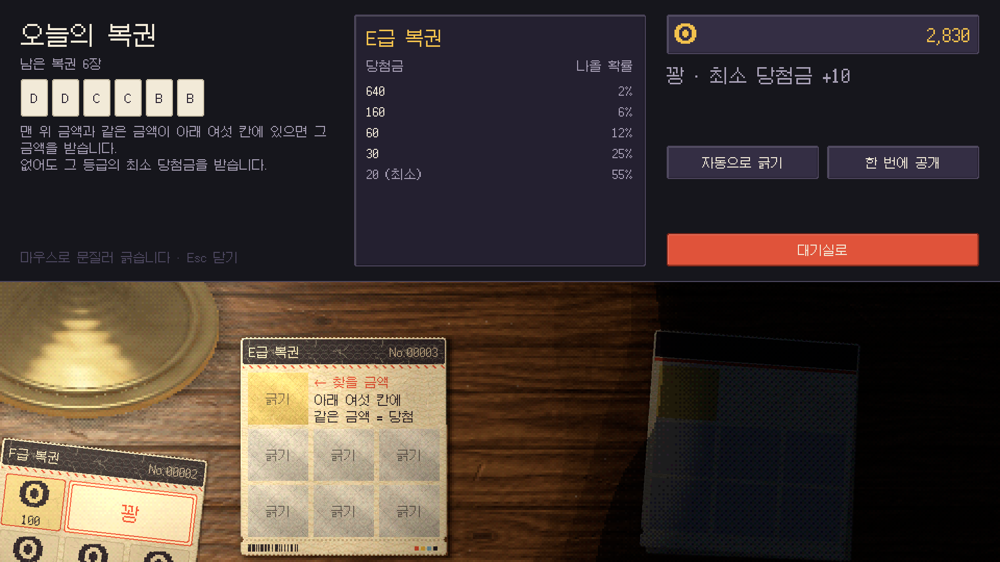
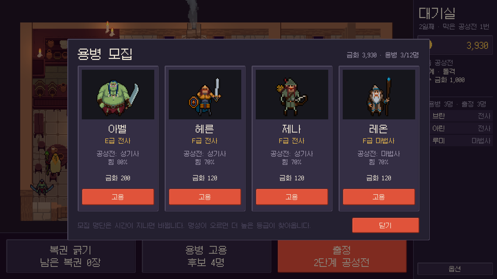
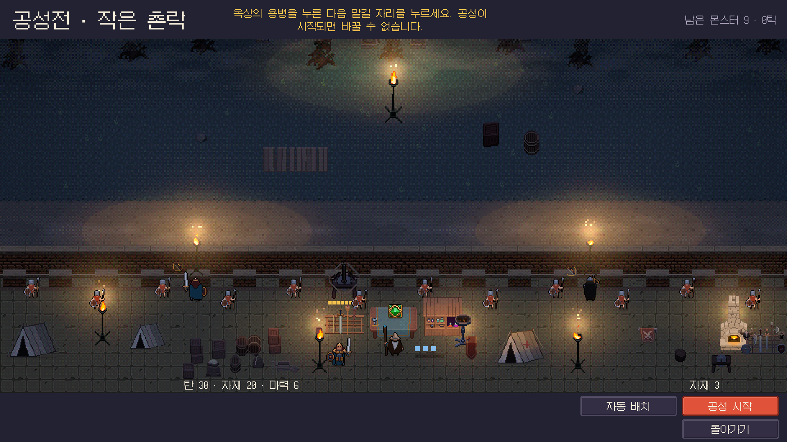
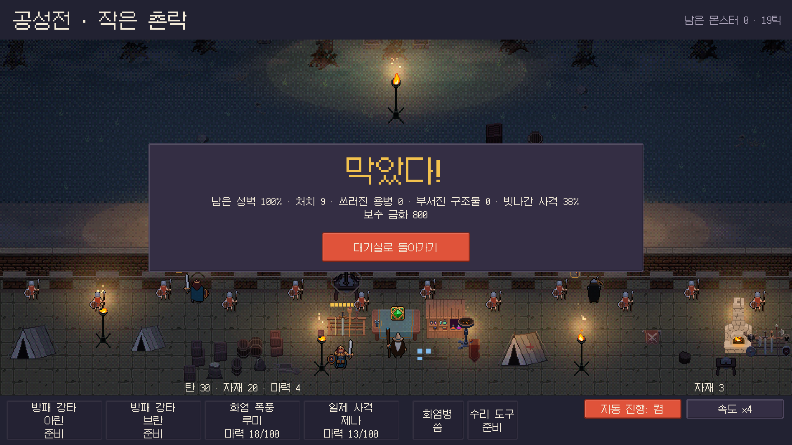

## 받은 주문

- 이전 용병단에서 만든 홀 씬(내 용병들이 서 있는 곳)을 대기실로 쓴다.
- 거기서 복권을 긁는다.
- 출정을 넣어 공성전에 간다.
- 용병을 산다.
- 시작 화면에서 시작하면 이 대기실부터다.

## 전과 지금

홀 씬의 화면은 세로 모바일용이었습니다. 가로 1920×1080에서는 위쪽만 크게 보이고 잘렸습니다.

{: .shadow }

가로 화면의 대기실을 새로 만들었습니다. 홀과 용병은 그대로 두고 그 앞에 세웠습니다.

{: .shadow }

- 왼쪽은 홀입니다. 홀의 픽셀 하나를 화면 3단위로 그려서 픽셀이 고르게 나옵니다.
- 홀 위의 표지 셋(복권 책상, 용병 모집, 출정)과 아래의 큰 버튼 셋은 같은 일을 합니다.
- 홀이 ㄴ자라 비는 구석에 "오늘의 일"을 두었습니다.
- 오른쪽은 날짜, 금화, 다음 공성전, 내 용병입니다.

## 하루

1. 아침에 복권 다섯 장이 생깁니다. 처음에는 F·E·D·C·B 한 장씩입니다.
2. 긁으면 금화를 받습니다. 긁지 않은 복권은 다음 날로 넘어갑니다.
3. 금화로 용병을 고용합니다.
4. 출정하면 공성전 한 판을 합니다.
5. 돌아오면 다음 날이고, 새 복권 다섯 장이 생깁니다.

## 복권 책상

복권 전투에서 만든 책상, 무드등, 종이 복권을 그대로 가져왔습니다.

{: .shadow }

- 맨 위 칸이 "찾을 금액"입니다. 아래 여섯 칸에 같은 금액이 있으면 그 금액을 받습니다.
- 없어도 그 등급의 최소 당첨금을 받습니다. 빈손인 복권은 없습니다.
- 당첨금과 확률은 화면 위에 항상 보입니다.
- 얼마를 받는지는 복권을 꺼낼 때 정해지고 바로 저장됩니다. 긁다가 게임을 꺼도 잃지 않고, 다시 켜서 다른 결과를 뽑을 수도 없습니다.
- 여섯 금액은 무작위로 고릅니다. 아깝게 빗나가도록 꾸미지 않습니다.

## 고용과 출정

{: .shadow }

고용은 이전 용병단의 모집 시장을 그대로 씁니다. 카드에는 그 용병이 공성전에서 무엇이 되는지와 힘을 더했습니다.

- 전사는 성기사, 궁수는 명사수, 마법사는 마법사가 됩니다.
- 힘은 등급으로 정합니다. F급 70%에서 등급마다 10%씩 오릅니다.
- 다치지 않은 용병이 6명까지 출정합니다.

{: .shadow }

공성전에는 내 용병이 자기 이름으로 섭니다. 끝나면 대기실로 돌아가는 버튼만 있습니다.

{: .shadow }

## 공성 단계의 수치

시작 용병 셋(전사 둘, 마법사 하나)으로 지도마다 100판씩 돌려서 웨이브 크기를 정했습니다. 모의 조종사가 한 것이고 사람 플레이가 아닙니다.

| 단계 | 지도 | 웨이브 크기 | 보수(금화) | 100판 중 막은 판 |
|---|---|---|---|---|
| 1 | 작은 촌락 | 40% | 800 | 81 |
| 2 | 돌격 | 60% | 1,000 | 79 |
| 3 | 혼성 습격 | 60% | 1,200 | 65 |
| 4 | 하늘과 갑각 | 60% | 1,400 | 46 |

갱신(11월 20일): 위 표는 마법 병기와 화염 폭풍의 피해를 줄이고 모의 조종사의 배정을 고치기 전의 값입니다. 지금 웨이브 크기는 70 / 90 / 85 / 75%이고, 시작 용병 셋으로 82 / 75 / 64 / 38판을 막습니다. 보수는 그대로입니다. 까닭은 [폭탄과 마법 병기 글](/posts/siege-abilities-engine/)에 있습니다.

4단계는 비행이 많은데 시작 용병에는 궁수가 없습니다. 고용으로 메우라는 뜻입니다.

## 저장

금화와 용병은 이전 용병단의 저장을 그대로 씁니다. 날짜와 남은 복권, 공성 단계는 새 저장에 따로 둡니다. 둘을 합치지 않고 따로 두기로 정했습니다.

## 확인한 것

- Unity EditMode 테스트 709건이 모두 통과했습니다. 새 테스트는 16건입니다.
- 시작 화면부터 코드로 버튼을 눌러 한 바퀴를 돌렸습니다.

| 단계 | 값 |
|---|---|
| 대기실 도착 | 1일째, 복권 5장, 금화 1,800 |
| 복권 두 장 긁기 | F급 당첨 400, E급 최소 20 → 금화 2,220 |
| 궁수 한 명 고용 | 금화 2,020, 용병 4명 |
| 공성전 | 19틱에 승리, 보수 800 |
| 대기실로 돌아옴 | 2일째, 금화 2,820, 복권 8장 |

## 아직 아닌 것

- 사람이 직접 해 본 플레이는 없습니다.
- 경제는 재지 않았습니다. 금화 환산(영지 돈 1 = 금화 10), 등급별 힘, 보수는 출발값입니다.
- 이전 용병단의 의뢰·돌봄 화면은 대기실에서 열 수 없습니다.
- 쓰러진 용병의 부상, 진 뒤의 수리비는 넣지 않았습니다.
