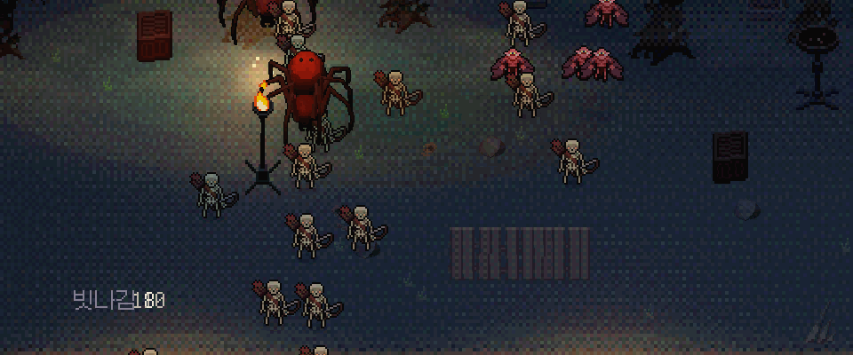
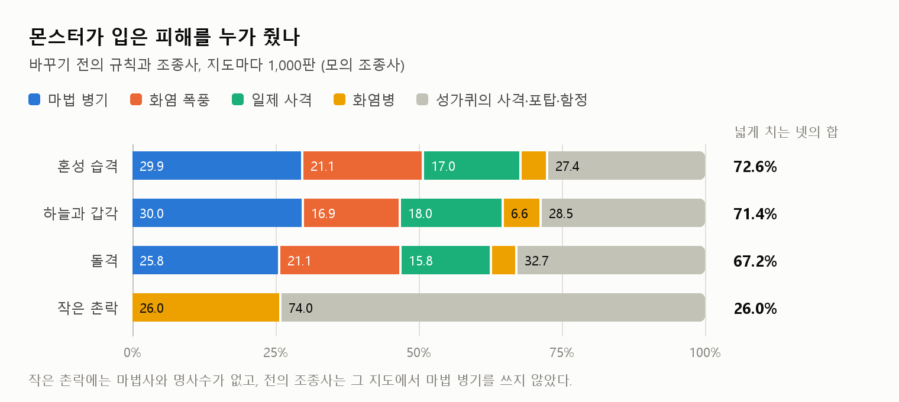
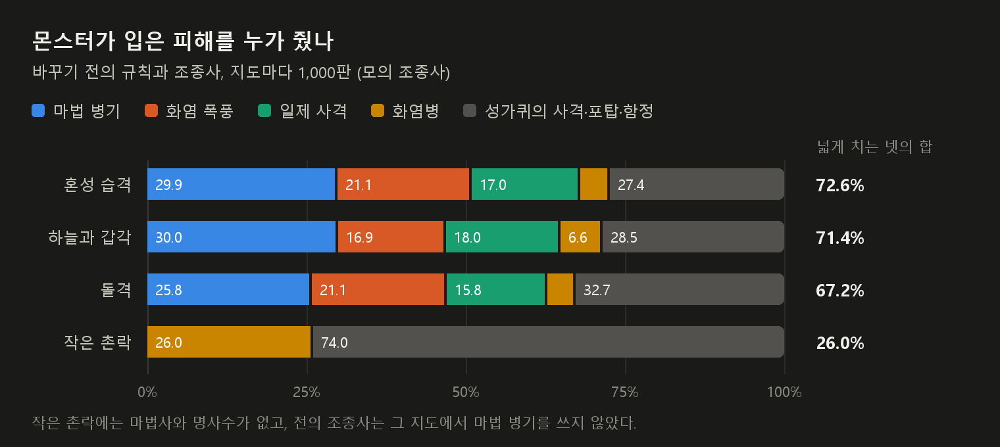
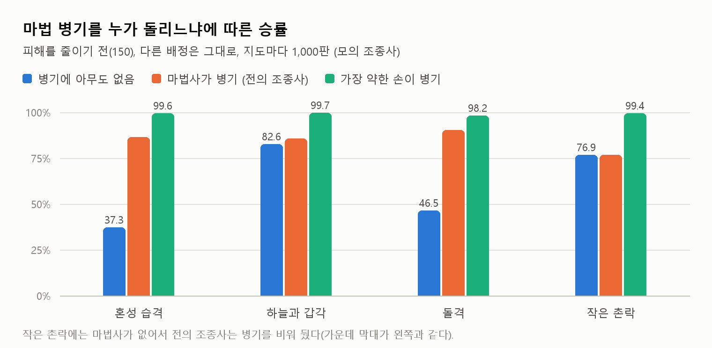
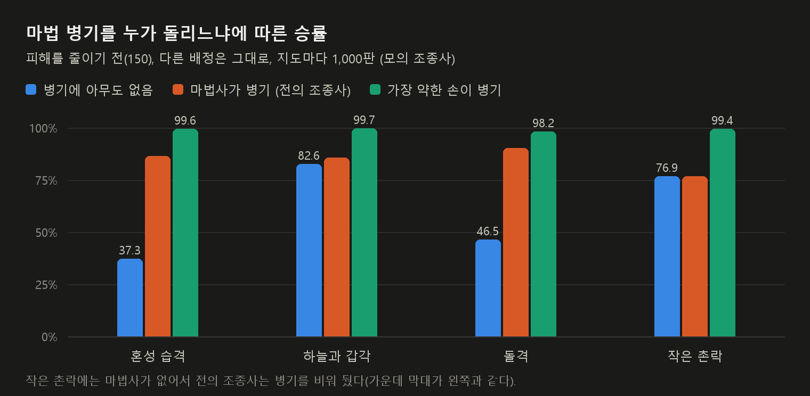

## 받은 말

[포인터를 올리면 외곽선이 뜨는 공성전 화면](/posts/siege-hover-outline/)을 보고 받은 말입니다(11월 19일).

- 폭탄과 번개가 한 번에 떨어진다. 번개는 그렇다 쳐도 폭탄은 차례로 떨어지는 편이 보기 좋겠다.
- 전체 타격 효과는 레벨 디자인적으로 사기인 것 같다.
- 레벨 디자이너가 있는가.

첫째는 화면의 일이고, 둘째는 재 봐야 아는 일입니다. 셋째의 답은 "없다"였습니다.

## 폭탄은 차례로

화염 폭풍(마법사)과 화염병(도구)은 맞은 몬스터 모두에게 같은 순간에 폭발이 떴습니다. 지금은 몬스터마다 폭탄이 하나씩 떨어집니다.

{: .shadow }
_혼성 습격 13틱, 가장 붐비는 곳에 화염 폭풍. 0.1초쯤마다 찍은 17장을 절반 속도로 이어 붙였다(자동 입력)_

- 조준한 곳에서 가까운 몬스터부터 떨어집니다.
- 폭발, 숫자, 움찔하는 동작, 쓰러지는 것은 그 몬스터의 폭탄이 닿을 때 나옵니다.
- 폭탄 사이는 0.09초입니다. 맞은 수가 많으면 전체가 0.7초 안에 끝나게 간격을 줄입니다. 하나가 떨어지는 데는 0.22초입니다.
- 규칙은 그대로입니다. 피해는 전처럼 한 번에 들어가고, 화면의 재생만 늦춥니다.
- 번개(마법 병기), 빙결 두루마리, 일제 사격은 그대로 뒀습니다.

걸린 곳이 하나 있었습니다. 구매한 폭탄 그림은 6픽셀입니다. 2배로 그렸더니 캡처에서 점으로만 보여서 4배로 그렸습니다.

바꾸기 전의 모습은 찍어 두지 못했습니다. 그래서 전과 지금을 나란히 놓은 그림이 없습니다.

## "사기 같다"를 누가 재나

지도와 웨이브를 맡는 역할이 따로 없었습니다. 이 프로젝트는 작업을 역할별 에이전트에게 나눠 맡기는데, 레벨과 조우는 기획 역할에 들어 있었습니다. 그 사이에 한 판을 이루는 표가 늘었습니다(공성전 지도 4개, 조우 4개, 웨이브 묶음, 미궁 층). 그래서 레벨 디자이너를 떼어 냈습니다.

- 레벨 디자이너는 지도·웨이브·조우 표를 고칩니다.
- 능력·몬스터·구조물의 수치와 규칙 값은 고치지 않습니다. 재서 변경안을 기획 쪽에 넘깁니다.
- 재는 방법은 둘입니다. 잘 판단하는 모의 조종사와 아무렇게나 하는 조종사의 승률 차이를 보고, 요소를 하나씩 빼고 다시 돌립니다.

첫 일로 둘째 말을 맡겼습니다. 지도마다 1,000판씩, 모든 표가 같은 시드를 씁니다.

## 결과 1: 느낌은 맞았다

{: .light }
{: .dark }
_바꾸기 전의 규칙과 조종사. 좁은 칸의 값은 아래 표에 있다_

| 피해를 준 것 | 혼성 습격 | 하늘과 갑각 | 돌격 | 작은 촌락 |
|---|---|---|---|---|
| 마법 병기 | 29.9% | 30.0% | 25.8% | - |
| 화염 폭풍 | 21.1% | 16.9% | 21.1% | - |
| 일제 사격 | 17.0% | 18.0% | 15.8% | - |
| 화염병 | 4.7% | 6.6% | 4.4% | 26.0% |
| 성가퀴의 용병 | 17.2% | 17.1% | 18.4% | 33.6% |
| 잡졸 | 5.2% | 5.1% | 7.3% | 15.6% |
| 포탑 | 3.7% | 3.3% | 3.6% | 24.8% |
| 함정 | 1.3% | 3.0% | 3.4% | - |

- 큰 지도 셋에서 피해의 67~73%가 넓게 치는 넷에서 나옵니다. 성가퀴의 용병, 잡졸 20명, 포탑을 다 합쳐 26~29%입니다.
- 다만 문제는 "들판 전체에 닿는 것"이 아니었습니다. 들판 전체에 닿는 능력은 빙결 두루마리 하나인데, 몫으로는 셋째나 넷째입니다.

하나씩 빼고 돌린 승률입니다(판단형, 큰 지도 셋).

| 뺀 것 | 혼성 습격 | 하늘과 갑각 | 돌격 |
|---|---|---|---|
| 없음 | 86.4% | 85.7% | 90.2% |
| 화염 폭풍 | 14.7% | 41.3% | 13.8% |
| 일제 사격 | 50.9% | 68.8% | 50.3% |
| 빙결 두루마리 | 57.8% | 70.0% | 77.6% |
| 방패 강타 | 70.7% | 71.2% | 75.3% |
| 화염병 | 71.8% | 76.4% | 80.9% |
| 수리 도구 | 76.8% | 75.5% | 79.9% |

- 누르는 능력 가운데는 화염 폭풍이 가장 큽니다.
- 쓸모없는 능력은 없습니다. 가장 작은 수리 도구도 빼면 9~10%p 내려갑니다.
- 하나만으로 이기는 능력도 없습니다. 큰 지도에서 어느 하나만 남기면 거의 0%입니다.

## 결과 2: 조종사가 쓰지 않던 수

마법 병기는 전투 중에 겨누지도 누르지도 않습니다. 사람을 세워 두면 몬스터가 가장 많은 곳에 알아서 터집니다.

규칙을 다시 읽어 보니 병기를 돌리는 사람에 조건이 없었습니다. 누가 돌려도 터지는 힘이 같습니다. 그런데 모의 조종사는 마법사에게만 병기를 맡겨 왔습니다. 그래서 배정에서 한 군데만 바꿔 쟀습니다. 가장 약한 사람(궁병대)을 병기에 두고, 마법사는 성가퀴에서 쏘게 했습니다.

{: .light }
{: .dark }
_병기의 피해를 줄이기 전. 같은 시드의 1,000판_

| 배정 | 혼성 습격 | 하늘과 갑각 | 돌격 | 작은 촌락 |
|---|---|---|---|---|
| 병기에 아무도 없음 | 37.3% | 82.6% | 46.5% | 76.9% |
| 마법사가 병기 (전의 조종사) | 86.4% | 85.7% | 90.2% | 76.9% |
| 가장 약한 손이 병기 | 99.6% | 99.7% | 98.2% | 99.4% |

- 그동안 적어 온 "판단형 77~90%"는 병기를 덜 쓴 조종사의 값이었습니다. 지도는 잰 것보다 쉬웠습니다.
- 네 지도의 답이 같습니다. 같은 한 수로 모두 98%를 넘습니다. 지도가 답을 바꾸지 못합니다.
- "사기"에 가장 가까운 것은 누르는 능력이 아니었습니다. 판단 없이 값이 나오면서 몫이 가장 큰 것은 병기 하나였습니다.

## 재다가 찾은 실수

- **앞선 측정의 두 줄.** 일자리를 하나씩 뺀 승률 가운데 "마법 병기"와 "짐꾼" 줄이 치우쳐 있었습니다. 일자리를 뺀 사람을 성가퀴에 세울 때 자리를 전체 인원으로 나눠 정했는데, 잡졸이 들어와 전체가 26명이 되면서 그 사람이 성벽 왼쪽 끝에 섰습니다. 병기를 뺀 값은 28.1 / 62.6 / 36.7%가 아니라 37.3 / 82.6 / 46.5%였습니다. 이 줄은 블로그에는 싣지 않았고 검증 기록에만 있었습니다. 기록에 정정을 붙였습니다.
- **방패 강타.** 기록에 "영웅이 선 자리에 쓴다"고 적었는데 규칙과 화면은 누른 곳에 씁니다.
- **맡긴 결과의 표본 확인.** 측정 기록의 수치 세 가지(기준선, 화염 폭풍을 뺀 값, 약한 손이 병기)를 따로 짠 코드로 다시 돌렸습니다. 열한 칸 가운데 열 칸이 같았고, 작은 촌락의 병기만 99.6 대 99.4%였습니다. 작은 촌락에서 고른 사람이 달랐습니다.

## 정한 것

후보는 여럿이었습니다(병기를 마법사만 쓰게, 병기의 피해나 주기, 화염 폭풍, 빙결의 반지름). 고른 것은 병기의 피해를 절반으로 줄이는 쪽입니다.

- 마법 병기 한 번의 피해를 150에서 75로 줄였습니다. 누구든 돌릴 수 있는 것은 그대로입니다.
- 모의 조종사를 고쳤습니다. 병기를 가장 약한 손에게 마지막에 줍니다. 배율을 판단형의 승률로 맞추는데, 판단형이 사람이 쉽게 찾는 더 강한 배정을 쓰지 않으면 맞춘 값이 실제 난이도를 말하지 못합니다. 화면의 첫 배정과 "자동 배치"도 같은 조종사를 씁니다.
- 웨이브 배율을 다시 맞췄습니다.

| 지도 | 웨이브 배율 | 판단형 | 일만 잘 정하고 스킬·도구는 아무 데나 | 무작위 |
|---|---|---|---|---|
| 혼성 습격 | 240 → 250% | 88.0% | 0.0% | 0.0% |
| 하늘과 갑각 | 170 → 180% | 87.7% | 0.1% | 0.0% |
| 돌격 | 240 → 230% | 90.4% | 0.1% | 0.0% |
| 작은 촌락 | 40 → 50% | 73.1% | 26.2% | 2.1% |

- 전체 피해에서 병기의 몫은 18.3 / 19.7 / 16.0%가 됐습니다(큰 지도 셋). 넓게 치는 넷의 합은 65.0 / 63.1 / 60.6%입니다. 줄기는 했지만 여전히 절반을 넘습니다.
- 작은 촌락만 낮은 까닭은 배율이 계단이기 때문입니다. 몬스터 수가 적어서(50%에서 열두 마리) 41~49%는 40%와 같은 수가 됩니다. 40%면 89.8%, 50%면 73.1%이고 그 사이 값이 없습니다.

조종사를 고치면서 한 번 틀렸습니다. 처음에는 손이 적어도 병기 자리를 미리 비워 두게 했는데, 용병이 넷인 작은 촌락에서 포탑을 잃어 82.4%가 나왔습니다. 포탑을 남기고 성가퀴의 가장 약한 손을 병기에 두면 89.0%였습니다(배율 40%). 그래서 손이 넉넉할 때만 자리를 비워 두게 했습니다.

## 대기실에 번진 것

[대기실](/posts/waiting-room/)의 공성 단계는 시작 용병 셋(전사 둘, 마법사 하나)의 승률로 웨이브 크기를 정했습니다. 그 측정도 같은 조종사를 씁니다. 조종사가 마법사를 병기에서 빼고 성가퀴에 세우자, 같은 크기에서 100판 중 100 / 100 / 100 / 90판을 막았습니다. 그래서 크기를 다시 맞췄습니다.

| 단계 | 지도 | 웨이브 크기 | 100판 중 막은 판 |
|---|---|---|---|
| 1 | 작은 촌락 | 40 → 80% | 81 → 79 |
| 2 | 돌격 | 60 → 90% | 79 → 86 |
| 3 | 혼성 습격 | 60 → 85% | 65 → 74 |
| 4 | 하늘과 갑각 | 60 → 75% | 46 → 49 |

2단계와 3단계는 크기 5%에 승률이 크게 움직입니다(2단계 95%면 51판, 3단계 90%면 53판). 처음의 79판과 65판에 더 가깝게 맞추지 못했습니다. 보수는 그대로입니다.

## 검증

- 규칙 테스트는 dotnet에서 75/75, Unity EditMode에서 709/709 통과입니다. 표와 조종사를 바꾼 뒤에 돌린 값입니다.
- 폭탄은 Play에서 13틱에 화염 폭풍을 써서 읽었습니다. 맞은 몬스터는 10, 쓰러진 것은 2였고, 폭발은 0.29초에 첫 번째, 0.89초에 열 번째가 나왔습니다.

승률은 모두 모의 조종사가 낸 값이고, 폭탄은 자동 입력으로 본 것입니다. 사람이 해 본 것은 아닙니다.

## 아직 안 한 것

- 화염 폭풍. 병기를 줄인 뒤 몫이 더 커졌습니다. 지금 빼면 3.7 / 38.8 / 5.1%입니다. 피해나 마력 회복을 줄이는 후보가 있지만 정하지 않았습니다. (글을 올린 날 줄였습니다. 아래 갱신에 적었습니다.)
- 빙결 두루마리. 쓸 때만 맞으면 어디에 던져도 값이 거의 같습니다. 반지름을 줄이는 후보가 있습니다.
- 사람 플레이. 약한 사람을 병기에 두는 수를 사람이 찾는지, 마법사가 성가퀴에서 쏘는 판이 어떻게 느껴지는지 모릅니다.
- 폭탄 연출의 속도 x2, x4에서의 모습과 화염병은 따로 찍지 않았습니다. 화염병은 같은 코드를 탑니다.

## 갱신: 화염 폭풍도 줄였다

글을 올린 날(11월 20일) "화염 폭풍도 줄이자"는 말을 받았습니다. 피해와 다시 차는 시간, 두 쪽을 지도마다 1,000판씩 재서 정했습니다.

- 화염 폭풍의 피해를 150에서 110으로 줄였습니다. 횟수가 아니라 피해를 줄였습니다.
- 150은 해골 궁수(체력 150)와 고블린 돌격병(135)을 한 번에 쓰러뜨리는 값이었습니다. 110이면 어느 몬스터도 한 번에 쓰러지지 않습니다. 횟수를 줄이면 "한 번에 다 쓰러지는" 장면은 그대로 남습니다.
- 약해진 만큼 웨이브 배율을 다시 맞췄습니다.

| 지도 | 웨이브 배율 | 판단형 | 화염 폭풍을 빼면 내려가는 승률 |
|---|---|---|---|
| 혼성 습격 | 250 → 225% | 90.2% | 84.3 → 64.2%p |
| 하늘과 갑각 | 180 → 170% | 94.1% | 48.9 → 24.3%p |
| 돌격 | 230 → 210% | 87.9% | 85.3 → 70.9%p |
| 작은 촌락 | 50% (그대로) | 73.1% | 마법사가 없는 지도 |

- 화염 폭풍을 뺀 몫이 일제 사격(71.6 / 39.9 / 65.5%p)과 비슷해졌습니다.
- 아무렇게나 쓰는 조종사는 여전히 못 이깁니다. 스킬·도구를 아무 데나 쓰면 0.0 / 1.4 / 0.0 / 26.2%, 일까지 아무렇게나 정하면 0.0 / 0.0 / 0.0 / 2.1%입니다.
- 하늘과 갑각은 맞는 배율이 없었습니다. 165~174%는 94.1%이고 176~180%는 78.9%입니다. 그 사이가 없어서 가까운 쪽을 골랐고, 이 지도는 전보다 쉽습니다. 무리의 구성을 손봐야 풀립니다.
- 대기실의 공성 단계는 1단계만 80%에서 70%로 옮겼습니다. 시작 용병 셋으로 100판 중 82 / 75 / 64 / 38판입니다.
- 규칙 테스트는 dotnet 75/75, Unity EditMode 709/709 통과입니다.

알아 둘 것이 셋 있습니다.

- 위의 GIF에는 피해가 150으로 찍혀 있습니다. 지금은 110이 뜹니다. 다시 찍지 않았습니다.
- 화염 폭풍의 피해는 예전 열 방식 방어전과 영지 규칙도 읽습니다. 영지 모의 실행(300영지)에서 막은 웨이브가 12 중 0.1~0.3 내려갔습니다. 그쪽 표는 다시 맞추지 않았습니다.
- 재다가 검증의 구멍을 하나 찾았습니다. 표만 고치고 에디터에서 테스트를 돌리면 옛 표로 돕니다. 테스트가 표를 한 번 읽어 붙들고 있기 때문입니다. 표를 고친 직후 에디터에서 화염 폭풍의 피해를 읽으니 150이 나와서 알았습니다. 그래서 전날 대기실 표만 바꾼 뒤에 돌린 709건은 새 표로 돈 것인지 알 수 없습니다. 이번 709건은 에디터가 새 값을 읽는 것을 확인한 뒤에 돌렸고, 그 대기실 표도 읽습니다.
