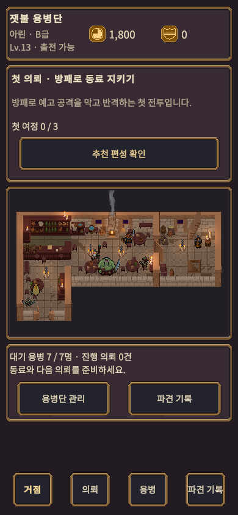
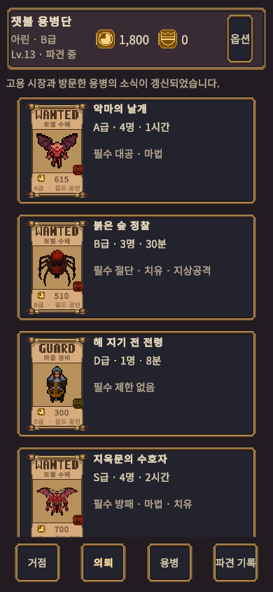
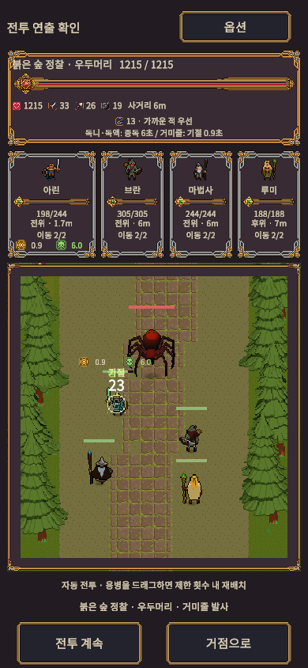

---
# 사이드바에는 테마 번역에 따라 '정보'로 표시된다.
title: 소개
icon: fas fa-info-circle
order: 1
---

혼자 기획 · 개발 · 검증하고 있는 개인 게임 프로젝트 **「잿불 용병단(가칭)」**의 작업 기록입니다.
지금은 PC Steam용 **긁는 복권 로그라이크**로 개편하고 있습니다.

> 모든 수치와 결과는 게임 저장소의 테스트 · 시뮬레이션 · 검증 문서에 근거합니다. 시뮬레이션과 자동 점검은 사람 플레이 검증과 구분해 적습니다.
{: .prompt-info }

## 한눈에

| 항목 | 내용 |
| --- | --- |
| 만든 사람 | 박인환 · Unity 클라이언트 프로그래머 · [GitHub](https://github.com/Inhwan98) |
| 현재 기획 | 긁는 복권 로그라이크 (PC Steam, 2026-11-13~ 초안) |
| 이전 버전 | 모바일 세로형 용병단 경영 시뮬레이션 (구현됨) |
| 엔진 | Unity 6000.3 · URP 2D · C# · Input System |
| 기간 | 2026.08 ~ 개발 중 |
| 아트 | 구매 에셋 Pixel Quest 시리즈 |

작업 현황은 [작업 트래커](/tracker/)에서, 기획 요약은 [기획](/design/)에서 볼 수 있습니다.

## 걸어온 길

| 시기 | 단계 | 내용 |
| --- | --- | --- |
| 2026.08 | 초기 탐색 | 오피스 관찰형 · 방치형 · 푸드트럭 시제품으로 방향 탐색 |
| 2026.08 ~ 09 | 고블린 게임회사 경영 | 게임을 만들고 미니게임 26종으로 직접 플레이. 출시 준비 검토에서 오래 성장하는 재미가 부족하다고 판단 |
| 2026.10 | 용병단 모바일 경영 | 편성 판정, 자동 파견과 오프라인 정산, 거점 돌봄, 미니게임을 의뢰 현장으로 재배치 |
| 2026.11.12 | 룬 릴 전투 (PC Steam) | 슬롯 릴 전투를 순수 C# 규칙 · 1,000판 시뮬레이션 · ML 에이전트로 검증 |
| 2026.11.13 ~ | 긁는 복권 로그라이크 | 반응속도 대신 '어느 칸을 어떤 순서로 긁을지'가 실력이 되는 구조로 전환 |

## 이전 버전 화면 (모바일)

Unity 에디터 Game View 390×844에서 캡처했습니다. 실제 기기 빌드는 하지 않았습니다.

{: width="390" .shadow }
_거점 화면_

{: width="390" .shadow }
_의뢰 게시판_

{: width="390" .shadow }
_자동 전투_

## 작업 원칙

- 결론에는 확인 가능한 근거(테스트 수, 시뮬레이션 표, 캡처, 문서)를 붙입니다. 근거가 없으면 가설로 적습니다.
- 규칙과 상태는 Unity를 모르는 순수 C#에 두고 EditMode 테스트로 검증합니다.
- 저장되는 enum 값은 고정하고 테스트로 강제합니다.
- 시뮬레이션 · 자동 입력 검사는 사람 플레이 검증이 아니라고 구분해 적습니다.

## 이 사이트

GitHub Pages와 [Chirpy](https://github.com/cotes2020/jekyll-theme-chirpy) 테마(MIT)로 만들었습니다. 유지비는 들지 않습니다.
게임 저장소는 비공개라, 글에 나오는 커밋 번호와 문서 이름은 링크 없이 적습니다.
